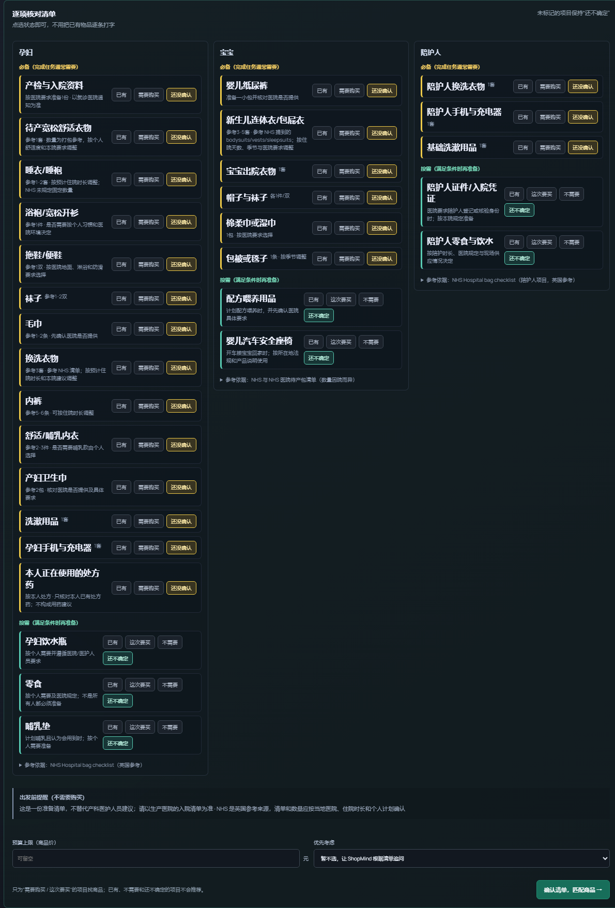

# ShopMind AI

> 把生活任务变成可核对、可调整的采购清单；只为用户明确决定购买的项目检索商品。

ShopMind 是一个 AI 产品作品集原型，面向第一次租房、出行、开学等经验不足的任务。重点不是多推荐商品，而是帮助用户发现缺项、复用已有物品、区分必备与按需，并理解哪些信息还需要确认。

**当前边界：**商品目录、价格和账户均为模拟数据；不接真实库存、支付、物流或订单。固定场景的本地流程已有验收记录，但清单内容正确性、真实商品相关性和用户/商业效果仍待验证。

## 产品预览

下面是本地浏览器验收中的待产清单页面：孕妇、宝宝、陪护人分模块，展示具体项目、数量/条件与必备/按需状态。NHS 内容是英国参考，需以当地生产医院要求为准。



## 作品集阅读路径

按“核心交付物 → 过程与证据 → 实际工作流”阅读：

1. **核心交付物**：[ShopMind 产品案例](docs/shopmind-portfolio-case-study.md)概览问题、产品判断、方案与结果；[PRD](docs/shopmind-task-to-plan-prd.md)记录目标、范围、规则与验收标准。
2. **过程与证据**：[数据证据评测](docs/aipm-data-evidence-review-20261023.md)说明指标、局限和下一步；[核心检索标注口径](eval/shopmind_core_annotation_guide_20261022.md)记录相关性判断方法；[端到端流程](docs/shopmind-mvp-detailed-flow-20261022.md)展开前后端与 Agent 分工。
3. **实际工作流**：[清单 UI 本地验收](docs/local-checklist-feedback-acceptance-20261023.md)和[租房/场景演示验收](docs/local-rental-demo-acceptance-20261023.md)留有全新 session、浏览器、API 和截图证据。它们验证的是本地固定流程，不是真人用户研究。

本仓库保留了早期 Ecommerce 跨境购物 Agent 的材料；[旧案例](docs/portfolio-case-study.md)和[设计演进记录](docs/设计演进记录.md)属于历史方向，不作为当前 ShopMind 的能力证据。

## 用户流程

```text
描述生活任务
  → 命中场景模板，或由 MainAgent 理解开放需求
  → 展示分组的具体清单
  → 用户逐项标记：已有 / 需要购买 / 不需要 / 未确认
  → 仅为明确待购项检索商品
  → 返回同品类候选，或解释模拟目录缺口
```

清单里的“必备 / 按需”是物品分类；“已有 / 需要购买 / 不需要 / 未确认”是用户对单项的判断。按需项中的“不需要”和“还不确定”含义不同，不会触发商品搜索。

## 当前覆盖

- **场景模板：**海边出行、一般出行、开学、租房、待产住院准备、第一次养猫；按模块组织具体物品、数量或条件。
- **逐项确认：**未提及不等于已有；状态变化只作用于对应清单项。
- **增量搜索：**新增槽位局部召回；预算/偏好变化时优先复用候选过滤重排；场景或核心用途变化时重算受影响范围。
- **事实约束：**商品属性与价格来自模拟目录；预算、品类等硬约束由应用逻辑校验，不允许模型编造商品事实。
- **响应式清单：**桌面三栏、平板两栏、手机单栏；必备用黄色、按需用绿色区分。

## AI 与规则的边界

| 部件 | 职责 |
| --- | --- |
| MainAgent | 理解开放式需求、维护多轮方案与用户状态、处理必要追问并组织回复 |
| SearchAgent | 根据方案变更召回、过滤、排序商品候选，不修改清单事实 |
| 场景模板与规则 | 已知场景的首轮清单优先走结构化模板；目录、价格和状态等确定性约束由代码处理 |
| TradeAgent | 保留扩展边界，但默认关闭，不属于当前 MVP 主链路 |

场景演示使用实际 LiveChat/API，而不是独立的固定问答页面；不过命中模板的首轮清单可能不调用大模型。是否发生模型调用以事件轨迹为准，不能把模板响应当作 LLM 质量证据。

## 接口与事件

- `GET /health`：检查本地服务状态。
- `POST /commerce/intents/stream`：提交对话并以 SSE 返回方案、检索进度和最终回复。
- `POST /commerce/intents`：非流式意图接口。

前端代理 `/commerce` 与 `/health` 到 `SHOPMIND_API_TARGET` 指向的后端。模板命中、模型调用、SearchAgent 调度和候选结果应按事件区分；接口成功本身不代表清单或推荐正确。

## 验证结果与局限

- **浏览器展示：**全新 session 实测待产、租房、第一次养猫清单；待产渲染孕妇/宝宝/陪护人三模块（17/8/5 项），租房三个模块，养猫五个模块；桌面/平板/手机列数为 3/2/1。此项验证页面与模板数据，不验证每条清单建议的专业正确性。
- **API 回归：**出行、开学、租房各跑“初始清单—确认—补充”三阶段，9/9 阶段通过；该轮 `model.call` 为 0，属于模板与目录流程回归。
- **检索探索集：**14 条海边/租房 Query，K=8；已知槽位过滤下临时参考集 Recall@8 0.743、Precision@8 0.809、MRR 0.857。170 个候选的人工相关性标签仍未完成，14 条 Query 均待标注，因此这些是探索结果，不是正式 Gold 指标或“推荐准确率”。
- **用户与业务效果：**尚无真人用户研究、真实 SKU 目录、采纳/转化或 ROI 证据。一次真实模型调用不构成质量结论。

## 技术栈与目录

- 前端：React 18、TypeScript、Vite
- 后端：Python 3.12、FastAPI、SSE
- Agent 编排：AgentScope 2.x
- 检索与存储：模拟商品目录、关键词/向量检索、SQLite；Redis、队列与外部检索服务按配置启用
- 模型：当前后端使用 SiliconFlow OpenAI 兼容接口上的 DeepSeek-V3.2；通过 `LLM_API_KEY` 注入密钥

```text
app/             Agent、领域逻辑、工具、API 与持久化
frontend/        React 对话界面与场景清单
eval/            固定用例、标注数据与评测产物
docs/            PRD、流程和评测边界
```

## 本地运行

需要 Python 3.11–3.13、`uv`、Node.js/npm 和模型服务 API Key。PowerShell 示例：

```powershell
uv sync
$env:LLM_API_KEY = "你的模型服务密钥"
$env:DATA_DIR = ".local-shopmind"
uv run uvicorn app.presentation.server:app --host 127.0.0.1 --port 8000
```

另开终端启动前端：

```powershell
cd frontend
npm ci
$env:SHOPMIND_API_TARGET = "http://127.0.0.1:8000"
npm run dev
```

打开 `http://127.0.0.1:5173/`。`SHOPMIND_API_TARGET` 将 `/commerce` 与 `/health` 代理到上面的后端。密钥只放本地环境变量或被 Git 忽略的 `.env`，不要写进前端或提交。

## 验证命令

在仓库根目录运行：

```powershell
uv run pytest
cd frontend
npm ci
npm run build
```

10 个脚本场景回归（请求需访问配置完成的 API）：

```powershell
uv run python scripts/eval_scenarios.py --base-url http://127.0.0.1:8000
```

脚本成功只证明该次自动化请求按断言运行；内容质量仍需参考答案和人工标注。
