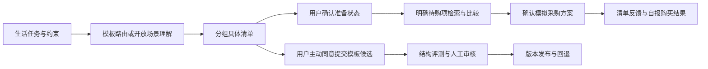

# ShopMind AI

> 把生活任务变成可核对的准备清单，由用户确认已有与缺口，再为明确待购项比较商品。

个人 AI 产品项目 · 本地 MVP · 文档更新：2026-10-25（北京时间）

[作品集总目录](docs/portfolio/README.md) · [产品案例](docs/shopmind-portfolio-case-study.md) · [PRD](docs/shopmind-task-to-plan-prd.md) · [可交互原型](docs/portfolio/02_需求与原型/prototype.html) · [GitHub 仓库](https://github.com/Pyper000/ShopMind)

## 产品解决什么问题

首次租房、第一次养猫或陌生旅行，用户可能知道目标，却不清楚该准备什么、已有物品本次能否使用、哪些只在特定条件下需要。ShopMind 把这些判断放进同一份可编辑方案，支持“已有 / 需要准备 / 还没确认 / 不需要”。

“需要准备”包含携带、办理和采购。护照等非商品只记录准备状态；可购买物品中用户明确要准备的缺项，才进入商品匹配。必备/按需描述建议属性，与用户的实际准备状态分开。

目标用户是正在处理陌生、多品类任务的人。现有访谈也包含靠记忆、到场补买、先基础后升级等反例，因此“清单对所有人都有用”仍是待验证假设。完整依据见[研究与机会判断](docs/portfolio/01_调研分析/研究与机会判断.md)。

## 一条完整的产品流程



游客可恢复本机对话；可选本地账号，库存与偏好仅在明确授权后跨会话使用。恢复对话、登录和长期记忆是三个独立机制。当前决策闭环与反馈闭环已有本地验收记录；真实订单、支付、物流和成交归因尚未接入。

## 当前能力与证据

| 能力 | 状态及证据范围 |
| --- | --- |
| 六类内置场景 | 海边、一般出行、开学、租房、待产、首次养猫；模板优先，含语义改写与对象冲突防护 |
| 统一清单 | 模板与开放场景共用 ShoppingPlan/checklist_sections；新场景要求 2–6 个模块，顶层任务与模块一致 |
| 明确缺口检索 | MainAgent/Orchestrator 管理方案，SearchAgent 按已确认槽位检索；模拟目录无匹配时显示缺口 |
| 清单与结果反馈 | 有帮助/还不够准确；买到/没找到/决定不买/还没买，均为用户自报 |
| 游客与授权记忆 | 本机恢复、可选账号、库存/偏好授权、撤回和清除已有实现与测试 |
| 模板治理 | 主动提交去标识化候选，结构评测后人工审核、版本发布与回退；非自动训练模型 |
| 天气与出行 | 已接入 Open-Meteo，区分预报/历史同期参考/信息不足/不可用；有数量、温度和雨雪规则 |
| 最新衣物迭代 | 成人/儿童拆分、换模板后的行程继承仍需专项多轮验收，未列为完成 |
| 交易能力 | TradeAgent 保留边界，当前 MVP 主流程不创建真实订单 |

验收记录是特定时点的证据。10 月 25 日早期闭环报告不能覆盖随后所有改动。最新全量测试为 **395 passed，1 warning**，前端构建通过；另有已确认的高 UV 分支缺陷与跨轮旅行风险，详见[评测与证据](docs/portfolio/04_评测与数据/评测与证据.md)。测试通过不等于不存在未覆盖缺陷。

现有反馈汇总中的 1 条测试会话、帮助率 1.0，只能验证记录机制；不能写成“用户帮助率 100%”。目前没有真实用户价值、转化提升或 ROI 结论。

## 面试官阅读路径

| 时间 | 建议打开 |
| --- | --- |
| 30 秒 | [产品案例](docs/shopmind-portfolio-case-study.md)：背景—目标—行动—结果 |
| 3 分钟 | [PRD](docs/shopmind-task-to-plan-prd.md) + [交互说明](docs/portfolio/02_需求与原型/交互与原型说明.md) |
| 10 分钟 | [架构与选型](docs/portfolio/03_架构与实现/架构与选型.md) + [评测证据](docs/portfolio/04_评测与数据/评测与证据.md) |
| 深入追问 | [竞品分析](docs/portfolio/01_调研分析/竞品分析.md)、[用户研究工具](docs/portfolio/01_调研分析/用户研究工具.md)、[项目复盘](docs/portfolio/05_迭代与复盘/阶段复盘.md) |
| 共享屏幕 | [演示与 GitHub 展示稿](docs/portfolio/06_演示与交接/演示与GitHub展示.md) |

原型是独立的设计说明，可离线点击；产品截图与 SSE 记录是实际运行证据，两者分开展示。旧版文档原文保存在[整理前版本](docs/portfolio/历史版本/20261025整理前/README.md)。

## 架构与技术选择

- React 18 + TypeScript + Vite：对话、模块清单、逐项状态和 SSE 渲染。
- Python + FastAPI：接口验证与 SSE；领域方案和应用逻辑管理状态、预算、搜索范围。
- AgentScope 2.x：Agent、工具和会话编排；版本约束为 agentscope>=2,<3。
- DeepSeek-V3.2：现有本地健康检查/历史模型事件中的配置模型；支持兼容网关配置，尚未进行正式多模型胜出评测。
- JSON 模板/模拟目录 + SQLite/文件持久化：本地 MVP；Qdrant、Redis、reranker 和队列为可选设施，启用状态以运行配置为准。
- Open-Meteo：地理定位、天气及历史参考；温度/降水来源标注，无法获取时降级。

AgentScope 不负责替业务判断用户是否已有物品。MainAgent/Orchestrator 是会话方案协调者，SearchAgent 不直接写用户库存或发布模板。详见[架构决策与替代方案](docs/portfolio/03_架构与实现/架构与选型.md)。

## 本地体验与开发

当前隔离验收入口：[http://127.0.0.1:5190/](http://127.0.0.1:5190/)，后端 8014。该地址仅供运行服务的本机访问。历史公网预览与本地代码未核对一致性，不作为本版验收入口。本文档整理未推 Git、未部署公网。

新环境需 Python 3.11–3.13、uv、Node.js/npm，以及配置好的模型服务密钥：

```powershell
uv sync
$env:LLM_API_KEY = "你的模型服务密钥"
$env:DATA_DIR = ".local-shopmind"
uv run uvicorn app.presentation.server:app --host 127.0.0.1 --port 8000
```

另开终端：

```powershell
cd frontend
npm ci
$env:SHOPMIND_API_TARGET = "http://127.0.0.1:8000"
npm run dev
```

新环境前端默认 5173；既有验收服务使用 5190/8014，应直接复用。Vite 将 /commerce 和 /health 代理到后端，API 应返回 JSON 或 SSE，未知 API 路径不能返回前端 HTML。

验证：

```powershell
.venv\Scripts\python.exe -m pytest -q
.venv\Scripts\python.exe scripts/check_portfolio_docs.py
cd frontend
npm run build
```

配置参考 [.env.example](.env.example)。密钥不进入前端与版本库。

## 仓库导航

| 目录 | 内容 |
| --- | --- |
| app/presentation | API、DTO、SSE |
| app/application | Agent 编排、工具、状态变更、天气清单规则 |
| app/domain | ShoppingPlan 与领域契约 |
| app/infrastructure | 目录、模板、天气客户端和持久化 |
| frontend | 实际产品界面 |
| tests | 功能与回归测试 |
| eval | 评测集、SSE、截图与验收记录 |
| docs/portfolio | 分阶段作品集、原型、研究工具与展示稿 |

[GitHub 展示稿与发布边界](docs/portfolio/06_演示与交接/演示与GitHub展示.md)已准备在本地；远端仓库尚未同步本次内容。
