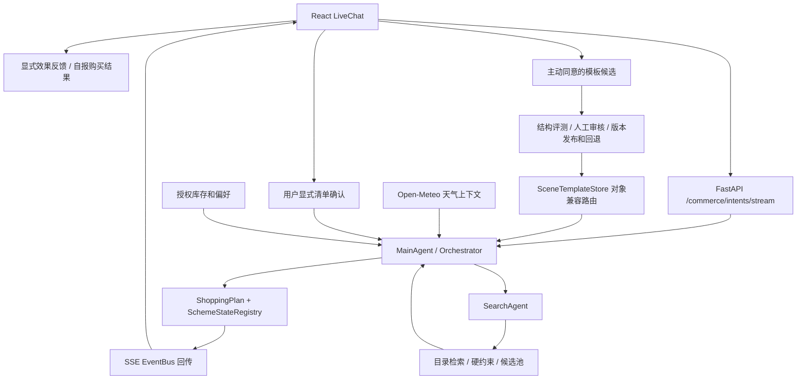

# 架构与选型

一句话：模型理解开放表达，统一状态和业务规则约束执行；所有路径都回到同一份可校验的准备方案。

代码核对：2026-10-25。当前基线为本地工作区，含未提交改动。技术选型理由为基于代码和任务约束的事后梳理，未声称存在当时的成本基准或正式选型实验。

## 1. 整体数据流与边界

MainAgent/Orchestrator 协调会话方案、反馈与预算偏好。SearchAgent 只负责已确认待购槽位的召回、过滤、排序和解释；不因搜索行为推断拥有，不写长期画像。TradeAgent 保留扩展边界，MVP不创建真实交易。

闭环分别是：任务决策闭环、反馈采集闭环、授权记忆闭环、内容治理闭环。以上都不能等同于真实成交闭环。

## 2. 关键选型、理由与替代

| 层 | 当前实现/选择 | 与产品需求的关系 | 取舍与替代 |
| --- | --- | --- | --- |
| Agent框架 | AgentScope >=2,<3 | Agent、工具、状态、派发与事件轨迹已有实现基础 | 若仅模板清单，普通函数足够；框架不保证业务正确，升级需回归 |
| 主模型 | 当前健康信息为 deepseek-ai/DeepSeek-V3.2，兼容协议网关 | 用于未命中模板的理解、追问与结构提交 | 无正式多模型质量/成本胜出实验，不能称最优；后续同集比较 |
| 前端 | React18、TypeScript、Vite | 多状态清单、对话流、候选交互，类型帮助约束字段 | Web MVP便于本地迭代；暂不增加原生客户端 |
| API | FastAPI、Pydantic、SSE | DTO验证和单向进度/计划回传适合请求式会话 | SSE为当前主路径；不为每条进度上WebSocket |
| 状态 | ShoppingPlan不可变快照、state_version、SchemeMutation | 可追踪变更，限制搜索重算范围 | 仍需验证复杂多轮字段继承和数组上限 |
| 数据 | JSON模板/目录、SQLite MVP表、文件会话/偏好 | 本地容易核对、可隔离DATA_DIR | 不是生产多实例一致性方案；不提前迁移重型平台 |
| 检索 | 关键词/可选Qdrant向量与reranker | 已确认槽位里提高候选覆盖和排序 | 硬约束与相似度分开；历史指标使用keyword_2gram，不冒称向量收益 |
| 天气 | httpx调用Open-Meteo、缓存与超时降级 | 把气温、雨雪转换成条件和数量建议 | 历史同期样本非预报；地理歧义必须确认；有未覆盖高UV缺陷 |
| 观测/并发 | EventBus、可选Redis/队列/缓存 | 拆分模型、工具、计划与候选时延 | 本地health显示Redis与队列关闭，不能声称已验证分布式能力 |

AgentScope框架职责核对：[官方2.0文档](https://docs.agentscope.io/)。天气字段与预报接口：[Open-Meteo官方文档](https://open-meteo.com/en/docs)。上述框架通用能力只解释选型，不表示项目启用了官方所有功能。

## 3. AI与确定性代码的分工

模型：识别开放目标/约束、组织模块、补充必要追问和解释候选。
代码：对象冲突阻断、数据形状、去重、用户状态冲突、商品硬约束、价格计算、授权校验、版本发布条件。
模板：已审核的初始准备方案；模板首轮可0次模型调用。
记忆：只接用户明确授权事实；相似物品、点击与候选曝光不等于拥有或喜欢。

输出契约是checklist_sections + ShoppingPlan，而不是任意自然语言被前端猜结构。工具规范化可以补形状，无法保证内容正确，需要内容评审与负例回归。

## 4. 搜索与成本设计

新增槽位只局部召回；预算/偏好变化优先复用候选过滤重排；场景/核心用途变化清除受影响候选。目录无匹配是合法业务结果，不拿跨品类商品凑数。

清单阶段避免自动调用搜索；提交清单后保留agent.dispatch、tool.invoke/result、agent.result。确定性目录快路省去不必要模型回合，但不能把其时延当模型性能。

天气当前在编排入口获取，可能增加请求等待。代码有10秒级上层超时，具体冷缓存/热缓存/P95需要分层测量；不能用单次API汇总接口的毫秒延时代表天气清单时延。

## 5. 持久化与接口

| 功能 | 入口/代码 |
| --- | --- |
| 任务与SSE | [server.py](../../../app/presentation/server.py)、[orchestrator.py](../../../app/application/agents/orchestrator.py) |
| 领域与状态变更 | [ShoppingPlan](../../../app/domain/session/shopping_plan.py)、[scheme_state.py](../../../app/application/agents/scheme_state.py) |
| 统一清单工具 | [shopping_plan_tool.py](../../../app/application/tools/shopping_plan_tool.py) |
| 账号/反馈/候选 | /commerce/mvp/auth/*、/feedback、/feedback/summary、/template-candidates；[MVP存储](../../../app/infrastructure/persistence/shopmind_mvp_store.py) |
| 授权记忆 | /commerce/mvp/memory/*；后端按token确定身份，游客不接受伪造账号身份 |
| 天气 | [客户端](../../../app/infrastructure/weather.py)、[清单规则](../../../app/application/travel_weather.py) |
| 客户端保存 | [LiveChat](../../../frontend/src/components/LiveChat.tsx)中的localStorage快照和session恢复 |

账号使用PBKDF2和限期token；浏览器localStorage持有token，属于本地原型方案。模板审核按本机来源限制；经本机反向代理时不能依赖该限制替代正式管理员认证。候选格式检查只能减少常见标识信息泄漏，不保证彻底匿名。

## 6. 下一阶段工程决策

优先修已复现高UV错误与旅行多轮约束，补专门回归；再核验32项领域上限与24项提交数组、数量文本与采购计价的边界。真实商品和公网认证应有独立设计与验收。当前工作区有混合历史电商组件，不等于ShopMind已具备所有订单功能。
