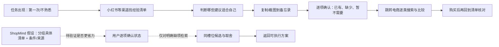
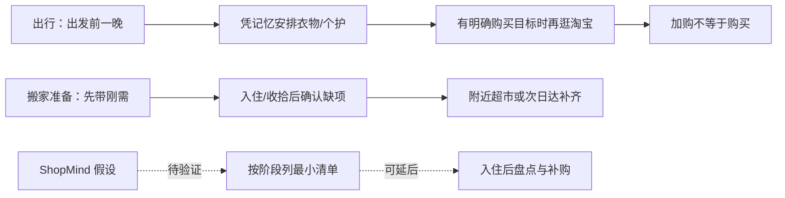
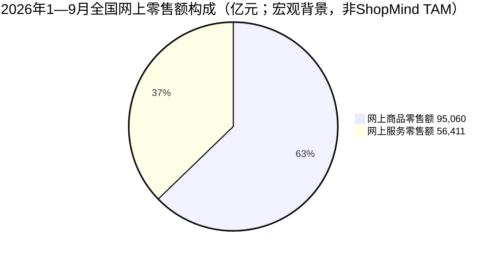

# ShopMind 项目背景研究：用户、数据与竞争格局

- 研究日期：2026-10-24
- 研究范围：项目背景与机会假设；公开资料桌面研究；下一轮用户研究方案
- 证据状态：公开资料已收集；用户研究材料来自创始人自述、群友 n=5 摘要、A–D 摘要、CAT-01 养猫经验者访谈及 TRIP-02 出行/搬家准备访谈截图，彼此是否重叠未知；本文件没有执行新问卷，也不声称市场需求已验证
- 使用边界：本文件用于明确要验证什么，不是市场规模报告、统计代表性调查或投资结论

## 一页结论

ShopMind 有一个来自创始人真实经历、值得研究的问题起点：面对第一次或高复杂度的生活任务，用户可能先在经验内容中找清单，再手工整理、核对已有物品，最后跳到电商平台购买缺项。但现有证据尚不能说明目标用户普遍有此痛点、愿意改变习惯或会为该服务带来可持续收入。此前 n=5 的群友摘要、CAT-01 养猫经验者访谈和新增 TRIP-02 出行/搬家准备访谈均有样本/记录限制，不能估算需求比例。

CAT-01 的新线索不是“用户会漏买”，而是“有经验用户倾向基础先买、逐步升级，选品在意来源与信任，也不一定信任广告式跳转”。TRIP-02 则是重要反例：出行时靠记忆、把小红书当攻略来源，搬家准备更像“先带刚需、入住后看缺什么再买”。因此产品需求应先收束为**可信、分阶段、可由用户确认的任务清单与决策辅助**，而不是全量清单+全品类推荐+一站式交易；养猫、搬家仍是候选场景，不是已验证首发市场。

当前更值得验证的不是“所有出行者需不需要清单”，而是：**当任务陌生、物品类别多、漏项代价高、并且需要跨来源/跨品类决策时，用户是否反复遇到清单整理和采购衔接问题？ShopMind 是否能比现有流程更省时、更少遗漏/重复购买，并让用户更有把握？**

竞品扫描也修正了一个重要假设：不能笼统说市场“很少打通清单和购物”。千问/淘宝、京东 AI 购、Amazon Alexa for Shopping、Google Shopping/Gemini 等已公开描述了对话式商品发现、比较或购物衔接；PackPoint、AnyList 等则验证了特定任务清单或清单到购物的品类方案。**尚未被公开资料证明、也尚未由本项目验证的空白**，可能是面向一般生活任务的可编辑原子清单、逐项“已有/购买/不需要/未知”状态、来源/条件说明，以及只把明确缺口映射到商品的“最小购买集合”工作流。这个空白是待检验的定位假设，不是已建立的竞争壁垒。

建议先做：

1. 先去重已有访谈，再选一个候选切口做关键事件访谈：首次长途/国际旅行、首次租房入住或首次养猫（若选养猫，用有经验者作对照）；先重建最近一次真实行为，不先介绍产品。TRIP-02 提供了短途旅行的负例线索，也提示要单独核实“入住后补齐”是否真实且可接受。
2. 做一次 6 个方案 × 2 个任务的竞品实测，明确每个产品在任务拆解、勾选状态、未知项、商品匹配和购买跳转上的真实能力。
3. 访谈后再发 60–90 份分层探索问卷；用最近一次真实任务而不是“你会不会用 AI”衡量行为。
4. 用主持式原型测试比较现有方式与 ShopMind，观察任务耗时、清单修订、遗漏顾虑、平台切换和决策信心。先证明用户价值，再测加购/转化。

**当前总判断：**上游消费场景很大，但 ShopMind 可服务的细分任务市场尚未量化；目前已经做出可本地验收的跨场景产品原型，却还没有证明哪类用户会反复需要它、清单足够可信或商品链路能带来结果。下一阶段应从“再补场景/功能”转为“选一个候选任务，与用户现有做法做对照验证”。

## 1. 用户背景与问题假设

### 1.1 创始人问题来源：一条可检验的真实旅程

创始人自述的场景是第一次欧洲旅行：在小红书找经验清单，获得日常衣物之外的提醒（例如防盗相关用品）；再把内容复制到备忘录逐项勾选，发现缺少的物品后跳转电商平台采购。清单像 SOP 一样帮助减少“我是不是漏了什么”的不确定性，勾选状态也带来阶段性安心；但搜索、筛选、复制、核对和购买分散在多个平台。



这段经历拆成 4 个彼此不同的待证问题，避免把“有清单需求”直接等同“需要 ShopMind”：

| 假设 | 用户可能获得的价值 | 需要观察的行为证据 | 反证/风险 |
| --- | --- | --- | --- |
| H1：复杂任务会让用户担心漏项 | 更完整、可按条件调整的准备清单 | 最近一次任务中实际查过多个来源、反复核对、事后发现遗漏 | 用户依赖经验和成熟服务，觉得遗漏风险低或不值得处理 |
| H2：跨平台手工整理造成摩擦 | 减少复制、重录和反复切换 | 用户确实把内容从笔记/帖子搬到清单，且能说出耗时和具体中断 | 大多数人直接收藏内容、截图或记忆，认为现状足够简单 |
| H3：勾选/状态能缓解不确定性 | 看清已拥有、待买、不需要和未知 | 用户当前已使用清单勾选/标记，或主动补充确认已有物品 | 用户只看清单但不持续更新；勾选没有改变信心或结果 |
| H4：明确缺项后接商品有价值 | 更快找到合适品类/商品，避免重复采购 | 用户曾从清单转到电商搜索；对商品比较和适配有实际困难 | 用户更愿意独立购买、已有固定平台/品牌；外链反而降低信任 |

### 1.2 当前一手用户证据：n=5，只能形成方向性线索

根据创始人提供的访谈摘要，曾询问 5 位群友出行是否会拿清单对照。总结是：多数人对短途出行不觉得有必要，可能因为经验较丰富且外卖/本地服务成熟；其中 1 位女生倾向于使用清单进行对照。

```text
明确表示倾向用清单对照       ● 1 人
其余 4 人的逐人原始答案       ░░░░ 未提供，不能逐人编码或推断为“反对”
样本总数                     5 人（熟人/群友便利样本）
```

这里不把 1/5 写成“20% 目标用户需求”，也不把口头总结转成“80% 不需要”：没有原始回答、明确问法、受访者出行经历、时间范围、记录稿和编码口径；且熟人/群友样本不是随机抽样。现有样本对产品有用的结论只有：**短途、熟悉任务可能是低需求对照组；至少存在一位明确倾向用清单对照的个体，值得继续追问她最近一次具体行为。**

#### 补充：A–D 访谈摘要（与上述 n=5 是否重叠未知）

创始人随后补充了 A–D 四个访谈摘要。由于尚无访谈编号映射、逐字稿、日期和筛选信息，**不能确认这是新增 4 人还是与前述 5 人部分重叠；以下只做主题归纳，不把样本合并计数，也不计算比例**。原话字段应保留真正逐字记录；目前提供的是研究者转述，不应加引号当用户原话。

| 受访者 | 任务/当前做法（按摘要转述） | 可观察到的行为线索 | 暂时的产品含义 | 证据缺口/反例 |
| --- | --- | --- | --- | --- |
| A | 不做清单；重要证件在脑中快速过一遍。漏了必需品会在当地买/用外卖补；非必需品会忍受没带 | 对某些物品，用户用记忆 + 到达地补救/放弃替代清单；有些用户不认为避免所有遗漏值得付出准备成本 | 产品不能默认“漏项焦虑”是普遍高痛点；需支持“当地补/不买/接受缺失”，不要把完整清单等同成功 | 未知真实遗漏次数、补救成本、是否曾造成严重后果、用户是否愿意提前准备 |
| B | 旅行时先看天气、穿搭和拍照需求；想起有同类型衣服时会翻衣柜/确认位置。以为有的衣服实际在家、不在宿舍；便宜配饰会补买，衣服会去淘宝挑；平时不用一次性用品，可能要另买 | “拥有”与“本次可拿到/可用”不等价；类别不同会选择重买、线上找、替代或有个人习惯 | MVP 可把“已有”与“本次可用/在什么位置”区分；个人偏好比“一次性”这个品类标签更决定是否买 | 该行为发生频率/花费未知；一次性用品是否必需及用户对一次性用品的接受度不可泛化 |
| C | 与朋友聊、在小红书做功课后决定养猫，再研究家中准备；覆盖吃喝拉撒、洗护和疫苗/驱虫等 | 首次高不确定任务会先找经验，再拆多个品类和服务/照护事项；购物清单与服务提醒容易混在一起 | 养宠可能是高复杂度研究场景，但物品、服务、健康事项要分开；健康/疫苗/驱虫只提示向兽医确认，不由清单模型作专业建议 | 是否实际制作/勾选清单、发生过哪些遗漏/重复、养宠支出和任务完成结果尚不清楚 |
| D | 马来西亚旅行前两天才开始准备；看天气、游玩天数和拍照穿搭，后来去线下试穿/买衣服 | 准备时间晚会改变购买渠道；服装的合身/试穿需求可能使线下优于线上 | 购买衔接不能只假设电商搜索；若用户明确想买，可保留线上、附近门店或先不买等选择 | 是否因为遗漏而临时买、线下购买耗时/成本、对清单工具的需求尚未确认 |

**当前能形成的跨访谈假设（不是频率结论）：**

1. 用户的任务策略可能有明显异质性：记忆、提前核对、当地补买、网购、线下试穿、替代或直接放弃都可能是可接受办法；“少漏项”不一定高于省时间/少操心。
2. 状态模型中的关键问题可能不是“用户拥有吗”，而是“本次能否拿到并使用”。但持久化个人资产库、订单同步和位置追踪还没有证据证明值得让用户承担录入成本与隐私成本。
3. 是否购买不能从“必备/按需”“一次性/耐用品”“天气/活动标签”自动推导。用户习惯、位置、剩余时间、试穿需求和当地可获得性都可能改变行动。
4. “第一次租房/养宠/长途旅行”可能比短途出行复杂，但本批摘要尚不能判定哪一类需求盘子最大、痛点最重或更商业化。

因此下一轮访谈应补问**结果与代价**：用户是否真的发生过“以为有、实际拿不到”、重复买、临时补买、当地购买更贵/更难，还是只是平稳地接受替代；对发生过的问题追问最近一次、频率和实际影响。也要纳入“不觉得麻烦”的负例。

#### 新增：养猫采购访谈 CAT-01（2026-10-24）

受访者有养猫经验。为保护隐私，研究文档不保留真实姓名；该样本与前述 n=5、A–D 摘要是否重叠未知，暂不合并计数。访谈记录是创始人整理的回顾文本，没有录音/逐字稿、招募方式和完整品类决策部分；以下为受访者行为摘要，不作为新手养猫人群的代表。

| 主题 | 受访者报告 | 对产品的含义 | 证据限制 |
| --- | --- | --- | --- |
| 初期准备 | 认为不必过度准备，先买基础用品、之后再升级；提到猫砂盆、猫屋、猫粮；未遇到漏买/临时将就 | 可验证“分阶段准备、先基础后升级”是否比一次列出全量用品更贴合用户；不要把更长清单等同更好 | 有经验养猫者回忆初期过程，不等于首次养猫用户；三项不能直接认定为完整权威清单 |
| 内容与选品 | 主要在小红书搜索评价；关注差评，差评少时较容易决策；猫粮会先买试吃装，适应后可能固定品牌 | 商品决策是品类特定的：猫粮可能需要评价证据与低成本试用，而非只靠通用“推荐理由” | 没有记录具体搜索词、比较对象、实际试用结果或评论判断准确性 |
| 新购与复用 | 自述对猫用品有“买新”的偏好；同时猫洗澡毛巾可用普通毛巾，吹风机可共用，风干箱视情况 | 偏好不能按用户或场景一刀切；要落实到具体品项和用户决定，提供“复用/新购/按需”选择 | “强迫症”是受访者的自我表述，不作诊断；对哪些物品买新、为何复用，需追问具体例子 |
| 症状/药品 | 受访者描述过先搜索内容、再决定是否去宠物医院，并通过即时渠道购买常规用品/药品的做法 | 这是高风险边界；产品不得把单一用户的自我处理经验转成医疗/用药建议 | 受访者提到的人用药减量给宠物的做法未经验证且可能危险，必须视为待纠正的用户认知；ShopMind 不提供药物、剂量或诊断指导，健康问题应联系兽医 |
| 购买链路信任 | 对清单+商品推荐“可以用但会顾虑”；希望来源正规、不买到劣质猫粮；接受先列清单再跳淘宝等平台，但担心广告影响可信度 | 商品链接本身不是价值；需要标明信息/评论来源、更新时间、商业关系和未知；无法核验商家时不能承诺正品/品质 | 是听到产品构想后的假设性反馈，非真实使用、点击、下单或付费证据 |
| 产品直觉 | 认为垂直专业感和被用户自然想起很重要；提及得物、小黑盒、装机助手作为产品形态联想 | “在养猫时会想到你”是品牌/心智与复用问题，不是增加一个清单功能就能解决 | 这些是受访者的类比和主观感受，不是对上述产品功能/商业结果的独立验证 |

**CAT-01 带来的收束：**当前养猫线索并非强“遗漏焦虑”证据，反而提示有经验用户可能不需要一次性备齐，而在意信任、品类特定的判断依据，以及逐步升级的节奏。新手用户是否会因为首次准备而需要分阶段清单，仍需直接访谈真正正在接猫/刚接猫的人。养猫可以继续作为**探索场景**，但目前没有证据支持把它确立为 ShopMind 的首发市场或把宠物药品放进购物决策 MVP。

#### 新增：出行/搬家准备访谈 TRIP-02（截图整理，日期未知）

为保护隐私，使用匿名编号 TRIP-02。材料是聊天截图，不是录音或完整逐字稿；访谈日期、招募来源、受访者任务经历细节及其与 n=5、A–D、CAT-01 是否重叠均未确认。因此按**一个个案的方向性线索**整理，不计入去重后的样本总数，不计算比例。截图中的部分细节由研究者追问引出，尤其搬家路径是否来自近期真实经历仍需核实。

| 场景/环节 | 截图中报告的行为（转述） | 用户问题/反证线索 | 对产品的暂时含义 | 证据强度与待核实项 |
| --- | --- | --- | --- | --- |
| 日常出行准备 | 通常出发前一晚收拾；穿什么、化妆/护肤用品等主要在脑中安排；小红书通常看旅游攻略，不专门找采购清单 | 对熟悉或短途旅行，受访者没有表达强烈的清单整理痛点；准备时间较晚，但是否因此出错不明 | 不应默认“旅行=需要完整清单”；短途出行可作为负向对照，先筛任务陌生度、时长、活动和跨品类复杂度 | 自述行为；出行次数、最近一次具体行程、遗漏/花费未知 |
| 漏项与补救 | 提到曾在想穿无袖衣服时才想起需要处理腋毛；她认为一些非必需品容易漏掉，但没有描述严重后果 | 可能存在“临出发才想起的小准备动作”，但目前是单个轻微例子，不足以证明焦虑或高代价 | 可探索把非采购准备动作（检查/处理/确认）与购买清单分开；先做可跳过的提醒，不把动作项伪装成商品 | 单一回忆例子；频率、影响、用户是否希望被提醒未知 |
| 商品决策 | 先想清楚要买什么，再去淘宝逐项看；会加入购物车，但是否购买不一定 | 用户可能在“明确品类意图”后才进入购物平台；加购不是购买，也没有说明商品比较本身困难 | 商品入口应在用户确认缺项并表达购买意图后出现；不能把外链点击/加购作为已验证价值 | 自述路径；购买转化、品类、决策耗时均未知 |
| 搬家/入住准备 | 对话中提到一份搬家时考虑要带走物品的列表；谈到新住处准备时，倾向先带刚需，入住收拾后再看缺项，附近超市补买或用京东次日达 | 不是“把所有物品提前买齐”，而是接受先最小准备、到场核对、再本地补齐；若该情境属真实经历，准备不足可能是可接受的阶段策略而非痛点 | 机会可能是“到场后盘点与缺项补齐”，而不只是出发前生成长清单；支持延后决定、本地购买、暂不购买 | 居住准备路径由访谈者引导讨论；是否真实搬家、实际漏项和补救成本尚未确认 |
| 当前替代方案 | 记忆、小红书旅游攻略、淘宝逐项浏览、入住后附近超市/京东次日达 | 这些替代方案可能已足够方便；用户没有说现有流程无法接受，也没有主动要求整合 | ShopMind 必须与“不使用新工具”的基线比较，证明减少整理/核对成本或提高决策把握；不能只证明自己能生成清单 | 仅是单个受访者陈述的渠道，未做竞品同任务体验或效率对照 |

**截图中可辨认的关键表达（非经录音核对的逐字稿）：**“这些都在脑子里想好”“小红书一般只看旅游攻略”“先只带刚需”“也不可能带齐所有东西”。它们支持的是受访者个人策略，不应写成目标人群共识。

**数据口径：**当前可记录为 1 份截图材料、1 个受访者个案（是否为新增独立样本未知）；可编码出其自述的准备/信息/购买/补救策略，但没有出行次数、漏项频率、清单耗时、补购件数/金额、购物转化等量化结果。因此不计算百分比、不外推市场规模，也不能判断“入住后补购”是否比提前购买更省钱或更省事。



**TRIP-02 带来的结论：**

1. **痛点不是“漏一件就焦虑”已被证实。**这位受访者多数出行依靠记忆，认为部分遗漏可以接受；没有说明发生过显著损失。它是对“所有旅行者都需要清单”的反例。
2. **跨平台并不自动代表流程摩擦。**她先形成明确购买目标再去淘宝，加购后可能不买；访谈没有证明她想把攻略、清单、购物整合到一个产品。
3. **更值得验证的是“分阶段准备”。**搬家/入住路径呈现“先带刚需—到场观察—补缺项”的行为线索；若能由真实最近一次搬家回放证实，产品应帮助用户决定何时核对、哪些可延后，而不是鼓励提前买齐。
4. **需要区分购买项和准备动作。**腋毛处理是个人护理准备动作，不是采购品；可作为“非购买提醒”假设，但单一轻微案例只支持研究，不支持立刻增加 MVP 范围。

**建议下一次追问 TRIP-02 或同类用户：**最近一次实际出行/搬家是哪次？任务前后各做了什么、何时决定买、是否出现忘带/重复买/临时补买？搬家后补购多少件、花了多少钱/时间？哪些东西选择不带？如果有清单，是为了防漏、少带、少买还是方便协作？她提到的搬家列表是否真的使用过，是否有截图/购物记录可回放？在回答这些之前，不把“搬家后补齐”当作已验证的产品需求。

**当前用户问题判断：有迹象，但尚未闭环。**

| 问题候选 | 当前材料实际支持到哪一步 | 判断 |
| --- | --- | --- |
| 准备信息和清单整理费力 | 创始人自身经历明确；部分小红书帖子下有人要求 AI 提取清单；CAT-01 搜索养猫准备；TRIP-02 旅行时主要凭记忆、小红书只看攻略 | 有问题发现线索，也有不使用清单的反例；尚未证明目标用户中高频或高成本 |
| 会误判已有物品/本次拿不到 | B 的旅行摘要有一个具体例子（同类型衣物在家、不在宿舍） | 有一个具体行为案例；发生频率、损失与可解决性未知 |
| 漏项带来强焦虑 | 创始人描述有焦虑；A 接受当地补买/忍受没带；CAT-01 没遇到遗漏；TRIP-02 提到轻微漏项但没有严重后果 | 不能作为跨用户的核心痛点结论；应把“减少焦虑”设为待验证结果 |
| 需要更完整、更多的采购清单 | CAT-01 主张基础先行；A 对非必需项会放弃；TRIP-02 出行靠记忆、入住准备倾向先带刚需 | “列全”可能导致过度准备/携带，与部分用户的最小准备和到场补齐策略冲突 |
| 商品推荐不可信 | CAT-01 对来源正规、品质与广告影响表达顾虑；用户也关注小红书差评 | 有明确但单人的信任线索；信任可能是采用门槛，不代表 ShopMind 已可解决 |
| 清单后还需要购物跳转 | 创始人经历了跨平台购买；CAT-01 对外跳转有条件接受但担心广告；TRIP-02 有明确目标后才去淘宝，加购未必购买 | 产品入口可作为后续测试；单纯加链接或把加购当转化目前没有差异化证据 |

因此现阶段不把产品痛点写成“用户普遍焦虑、经常漏买”。更贴合证据的说法是：**部分陌生任务准备者会搜索经验并自行整理；另一些人依靠记忆、先准备刚需、到场后再补齐。在特定品类和情境下，用户可能需要判断建议是否适用、已有物品是否本次可用，以及是否值得现在购买。当前未知这些摩擦的普遍性和代价。**

### 1.3 目标用户不是“所有旅行者”

现阶段建议用任务条件筛选，而不是用年龄/性别做画像。性别目前不是有证据支持的区隔变量。

| 目标人群假设 | 最近任务 | 为什么值得研究 | 关键风险 | 首轮配额建议 |
| --- | --- | --- | --- | ---: |
| 第一次长途/国际旅行 | 过去 12 个月完成或正在准备；多天、多目的地/特殊活动，或长途首次出行 | 与创始人的欧洲旅行经历贴近；可能有较多条件项、经验型提醒和跨品类物品 | 常见旅行清单/攻略已足够；短途用户的经验不能外推到此群 | 5 位 |
| 第一次租房入住 | 过去 12 个月首次独立租房，尤其房间物品不齐 | 多品类、尺寸/房屋已有配置会影响购买；存在重复购买或漏买的现实风险 | 一次性任务、房东已配物品、预算压力会影响结果；清单需要结合房间条件 | 5 位 |
| 有经验的短途旅行者（负向对照） | 过去 12 个月短途旅行至少 2 次 | 检验现有观察：经验、外卖/到店购买能否降低清单价值 | 若把此人当核心样本，会把产品误导成“所有出行都要清单” | 3 位 |
| 首次养猫（候选验证段） | 正在接猫或接猫不超过 6 个月 | 和 CAT-01 的有经验用户形成对照；验证初期采购是否需要分阶段清单 | 目前 CAT-01 有经验、无遗漏；高风险健康内容要排除 | 若选择该场景，5 位新手 + 3 位有经验者作对照；替换其他场景配额，不默认全做 |

原定 13 位（首次长途 5、首次租房 5、短途对照 3）是一个**探索性访谈方案**，不是统计抽样，也不是必须同时研究的清单。A–D、CAT-01 和 TRIP-02 是否与已访 n=5 重叠未知，所以先做样本台账去重，再按研究目标补齐缺口，而不是默认还需完整再招 13 人。TRIP-02 可作为短途/记忆式准备的负向线索，但她的具体行程和搬家经历都需核实；不能据此直接排除旅行或确立租房切口。CAT-01 是有经验养猫者，不能代替新手样本；若把养猫列为候选切口，建议以“5 位首次/近期新手 + 3 位有经验者对照”替换其他场景的配额，而非叠加所有场景。待产、开学、养宠等场景还需考虑专业审核成本，不要同时展开多个垂直市场。

### 1.4 暂定 JTBD 与核心价值主张

**待验证的 JTBD：**当我第一次或很少遇到一个复杂生活任务，不确定哪些建议适用于我、哪些已有物品本次拿得到、哪些值得现在买时，帮我把可信经验整理成一份分阶段、可修改的清单；由我确认复用、购买、延后或不需要，减少手工整理和决策摩擦，而不是承诺零遗漏或让清单越长越好。

这比“AI 生成购物清单”更准确，也更可测试。核心体验应在一份购物方案之外展示：

- 为什么要准备/在什么条件下才需要，以及参考来源或信息时效；
- 哪些是必备、按需、已有、要买、不需要、仍未知；
- 由用户确认的缺口如何映射到商品，为什么推荐、哪些事实未知；
- 用户可明确选择不买，且不因“清单更长”而被诱导多买。

### 1.5 访谈字段与 MVP 需求优先级

目前访谈字段草案覆盖了很好的关键事件：场景、决策主导权、是否做清单、启动时点、信息源、确认已有物品的办法、误以为有但实际拿不到、重复购买、缺项发现时间、补救渠道、替代、闲置、当地购买原因、主动忍受没带、情绪峰值、原话及产品介入假设。建议保留，但增加以下字段以便比较不同人/场景：

| 字段组 | 建议补充 | 原因 |
| --- | --- | --- |
| 样本和记忆边界 | 匿名受访者 ID、招募来源、任务发生月份、是否首次、任务规模/同行人数、访谈记录方式、是否经同意查看材料 | 可去重、识别熟人偏差、控制回忆时间；避免把不同任务混为一个样本 |
| 任务与工具 | 各步骤开始/结束时间区间、实际使用的 App/网站/纸面工具、切换次数、清单是“看过/收藏/复制/逐项勾选”哪一种 | “用了攻略”不是“做了清单”；平台切换需要由真实路径支持 |
| 逐项事件表（每件物品一行） | 物品/品类、最初判断、如何核实、是否在当前地点、最后决定（带/买/借/替代/不买/未知）、实际结果、耗时/金额区间 | 让“误以为有”“重复买”“补救渠道”有明确分母与结果；避免只留下印象深刻案例 |
| 用户影响 | 是否造成延误/不便/额外花费/安全或舒适影响；影响等级由受访者描述，不由研究者擅自推断 | 区分轻微不便与真正高代价问题，帮助优先级判断 |
| 原话与假设 | 逐字原话单独记录；研究员观察、解释、产品假设分别存列；先问行为再做“希望产品在哪一步介入”概念题 | 降低诱导和事后合理化；不把研究员总结伪装成用户语言 |

### 1.6 对所提伪代码的产品评审

这段伪代码是很好的**待验证规则清单**，但还不该直接作为产品逻辑：它把物品必要性、用户拥有状态、本次可获得性和购买渠道揉在一起，且多条默认规则会制造错误购买建议。

| 规则 | 问题 | MVP 调整建议 | 优先级 |
| --- | --- | --- | --- |
| R-01 一次性用品默认需买 | B 的摘要已显示有人不习惯一次性用品、偏好自带普通毛巾；一次性属性不等于没有/需要买 | 不根据品类推导购买状态；初始状态保持“还不确定”，用户确认偏好、已有物品和本次用途后再更新 | P0 |
| R-02 资产库命中就标已有 | 即使命中也未必在本次出发地点、拿得到或适合本次任务；但此逻辑还假设已经有可用的个人资产库，录入/隐私成本未知 | MVP 不做自动资产库；用户说“有”后只问会影响本次决策的问题：“这次能带到/拿到吗？”可标“有，但不在手边/待确认” | P0 |
| R-03/R-04 天气/活动/拍照动态项直接转购买 | 天气/活动只说明适用性，不说明用户没有该物品或决定购买；必要性也不等于购买状态 | 将动态来源仅用于增删/标注“适用条件”；每项初始仍为未知，由用户决定已有、要买、不需要 | P0 |
| R-06 出发前 3 天按固定渠道排序 | “<3 天”阈值无用户证据；线下试穿、目的地可获得性、地区配送和用户偏好都影响渠道 | 只有用户明确选择购买后，询问时间/地区/是否需试用，再展示可选渠道；MVP 先允许用户选择，不硬编码最优排序 | P1 |
| R-07 不需要时按目的地价格/可得性提醒 | 当地是否买得到、价格比值 1.5 等数据未必真实或可获得；对“明确不需要”反复劝说会损害控制感 | 保留用户的“不需要”；仅当有可靠、可追溯信息且后果重要时，轻量提示一次，不阻止、不覆盖其决定；没有数据就不提示 | P1 |
| `user.id` 从未定义 | 当前函数参数只有 `user_state` 和 `ctx`，却调用 `asset_db.find(user_id=user.id...)`，实现上会报错/引用未定义对象 | 若未来真要资产库，显式传入 user identity 与授权态；但 MVP 先不建设此依赖 | P0（若编码前） |

建议 MVP 先只实现这条状态纪律，而不是用户资产数据库：

```python
def initial_item_state(item):
    # 必备/按需/条件项只描述清单建议，不推断用户是否拥有或是否要买
    return "unknown"

def apply_user_decision(item, decision, context):
    # decision 必须来自用户明确选择或用户明确陈述；不能由物品类型/天气/活动自动生成
    if decision == "owned":
        if context.availability_for_this_task is False:
            return "owned_but_unavailable"  # 例如物品在家里，本次人在宿舍
        if context.availability_for_this_task is None:
            return "availability_unconfirmed"
        return "owned_and_available"
    if decision in {"buy", "not_needed", "borrow", "substitute", "unknown"}:
        return decision
    return "unknown"

def suggest_purchase_channels(item, user_decision, context):
    # 仅对用户明确要买的物品建议渠道；地区/时效/试穿等信息未知时保持未知
    if user_decision != "buy":
        return []
    return channels_supported_by(item, context)  # 按可验证供给与用户偏好展示，不伪造库存/价格
```

其中 `owned_but_unavailable`、`borrow`、`substitute` 是否作为正式 UI 状态，仍需原型测试；可以先在逐项备注/决策路径里表达，不必为了四个访谈摘要立刻扩张状态机。核心验收原则是：**必要性 ≠ 拥有状态 ≠ 本次可用性 ≠ 购买渠道；未知保持未知，用户选择不买后不被规则覆盖。**

### 1.7 根据当前访谈线索的需求优先级

| 优先级 | 需求/产品能力 | 当前依据 | 下一步验证 | MVP 建议 |
| --- | --- | --- | --- | --- |
| P0 | 用户能把建议项逐条确认，不让系统默认“已有”或“要买” | B 有“记得有但实际不在当前地点”；A 用记忆/当地补救 | 追问这种误判发生频率、后果，以及是否愿意多点一次“本次能拿到吗” | 保留未知默认；用户主动确认；必要时区分拥有与本次可用 |
| P0 | 可明确不买、接受替代或到达后补救 | A 会忍受漏带非必需品并当地购买必需品；B 可能购买替代品；TRIP-02 描述先带刚需、入住后再补 | 哪类遗漏绝不能接受，哪类愿意忍；补救成本是多少；“入住后补齐”是否来自真实任务 | 不把完整度/购买数作为唯一成功指标；允许不买、替代、当地再买或延后确认 |
| P0 | 清单建议有条件/数量/来源，适配不同任务 | B/D 结合天气、穿搭和天数；C 先找朋友/小红书了解养猫准备 | 哪些条件真正改变清单；来源对用户决策影响 | 先单一高复杂度场景，结构化解释适用条件；专业事项另行审查 |
| P1 | 明确缺项后支持不同采购/获取路径 | B 用淘宝挑衣服，D 线下试穿，A 当地买/外卖 | 哪些品类必须试、用户常用渠道、紧急程度对转化影响 | MVP 先提供用户选渠道/跳转，不做“3 天内自动推荐即时零售” |
| P2 | 个人资产库、位置记录、订单同步、自动猜测已有物品 | 仅有少量口头线索，且需要用户录入/授权和隐私处理 | 测用户是否愿意建立并维护资产、准确率和节省时间是否匹配 | 暂不做；先验证单次会话手动确认是否已够用 |

这只是**问题风险与验证顺序**，不是需求人数优先级。当前摘要不足以判定哪条需求盘子大；真正的用户/场景优先级需等按场景去重的访谈记录、行为分母和原型任务结果。

### 1.8 收束后的产品需求与机会优先级（跨场景 MVP）

结合旅行、租房/养宠早期摘要、CAT-01 和 TRIP-02，现阶段应把 ShopMind 从“生成详细清单并推荐所有商品”收束为**帮助用户对陌生任务做分阶段、可核对、可信的采购决策**。它的核心不是全量清单或交易闭环，而是判断“当前阶段该做什么、哪些可复用、什么条件下才需要、哪些可以到场后再决定，以及确实决定买什么”。

| 优先级 | 产品机会/需求 | 证据依据 | MVP 形态与边界 | 当前状态 |
| --- | --- | --- | --- | --- |
| P0（先验证） | 分阶段的最小准备方案：先做当前阶段必要项，非必要项按条件/触发时点再决定 | CAT-01 认为养猫先备基础用品、之后升级；A 接受补救/放弃；TRIP-02 描述先带刚需、入住后再检查 | 清单项区分“现在要准备 / 条件触发 / 到场后确认 / 后续可考虑”；说明为什么、何时需要；不给所有项目默认购买状态 | 方向性行为线索；TRIP-02 搬家路径尚未证实为真实事件，先做行为回放和原型验证，不直接加大开发 |
| P0 | 用户确认状态：未知、已有且本次可用、已有但本次拿不到、要买、不需要/替代 | 旅行 B 的位置误判；CAT-01 对用品有个人新购偏好、同时有家庭物品复用 | 初始不推断拥有/购买；用户可复用、购买、跳过或记录未知；本次不可用仅在影响决策时确认 | 规则合理，交互成本和状态是否过细待测 |
| P0 | 建立“可信”而非只输出商品：来源、更新时间、商品关键事实、差评/风险信息、商业关系透明 | CAT-01 明确担心劣质猫粮/广告影响信任；小红书选品关注评价与差评 | 原型展示可追溯来源和未知；无真实目录/授权/商家核验时不宣称正品保障、不声称已验证差评质量 | **当前模拟目录无法满足商品信任承诺**；真实供给和内容审核是交易能力的阻塞项 |
| P0 | 允许不买、当地补买、替代或延后升级 | 旅行 A 接受当地补/忍受未带；CAT-01 倾向后续升级；TRIP-02 不追求把搬家物品一次带齐 | 用户做决定，产品不以“清单完成率/GMV”强迫买齐；支持“入住后再确认”；替代建议需有来源并可跳过 | 符合少买目标，仍需确认入住后补购是否真实、成本是否可接受 |
| P1 | 按品类提供不同的决策辅助 | CAT-01 猫粮看差评/试吃装；用品可能买新也可能复用；旅行衣物可能需要线下试穿 | 不做统一“AI 推荐”模板；先在一个低风险品类验证评价证据/试用选项，再扩展 | 有具体行为线索，但只来自一位有经验用户 |
| P1 | 对明确缺项提供外部购买入口 | CAT-01 有条件接受外跳但担忧广告；TRIP-02 是先有明确目标才去淘宝，且加购未必购买 | 只有用户选择购买后展示平台入口；同时呈现匹配理由、来源和商业关系；不把跳转称作交易闭环 | 尚无主动整合需求、真实点击/采纳或购买转化证据 |
| P2 | 垂直品牌心智、完整交易闭环或自营可信商品池 | CAT-01 认为专业垂直和自然想起重要，并类比其他产品 | 暂不建商城/自营/复杂交易；先测用户是否会在下次任务回访，再核算内容审核、供给、履约和售后成本 | 战略想象，不是已验证机会 |
| 明确不做 | 养猫药物诊断、药品剂量、用人药或自行调整剂量建议 | 访谈中出现未经验证的自我用药做法 | 健康问题转介兽医/正规专业资源；采购清单与医疗指导分离 | 安全边界，不进入 ShopMind 建议逻辑 |

**机会排序结论：**

1. 先验证“分阶段、可信且可解释的任务清单”，尤其是“先带/买刚需、到场后盘点”的路径；不要先做更长清单或增加商品数量。
2. 状态与选择权是底层规则：初始未知；区分拥有与本次可用；明确支持不买、复用、替代、后续再买。
3. 商品可信度先于一站式闭环：模拟商品和外链无法兑现“正规/不买到劣质”的承诺。没有可靠商品事实、来源与商业关系披露前，宁可做决策辅助原型，不宣称购物保障。
4. 养猫先做小范围新手研究，不直接成为主赛道：现有唯一养猫受访者是有经验者、无遗漏、偏向渐进准备；须补访至少 5 位正在接猫或接猫不超过 6 个月的新手，并找 3 位有经验者作对照，再决定是否进入 MVP。此配额用于方向探索，不是市场规模抽样。
5. 垂直化和交易平台化放后：ShopMind 当前场景横跨旅行、租房、待产和养宠，资源有限时先通过同一套状态与可信清单框架验证一个切口；完成用户价值验证后再讨论垂直内容资产、商家合作或交易闭环。

## 2. 数据背景：现有数据能证明什么，不能证明什么

### 2.1 已收集的公开数据

国家统计局 2026 年 1–9 月数据：全国网上商品和服务零售额 **151,471 亿元**，同比增长 **4.4%**；其中网上商品零售额 **95,060 亿元**、增长 **3.8%**，网上服务零售额 **56,411 亿元**、增长 **5.3%**。这说明线上交易基础设施和消费规模很大，但不是 ShopMind 可服务市场规模，不说明清单场景需求、目标用户数量、客单价、平台佣金或 ShopMind 转化率。统计局还说明对网上消费统计指标进行了完善，引用时应使用同一口径，不把宏观总额直接当 TAM。



小红书校园招聘官方页面称“超过 70% 的活跃用户在小红书上有主动搜索行为”。这是一条平台自身的公开陈述，页面没有给出调查时间、样本、定义或方法；它支持“小红书搜索是值得研究的内容发现触点”，**不证明旅行清单用户占比、不证明用户会跨平台复制、不证明对清单购物产品有付费意愿**。平台的流量/搜索规模与 ShopMind 的需求不是同一件事。

### 2.2 证据成熟度盘点

| 证据层 | 当前已知 | 可信度/局限 | 尚缺关键数据 |
| --- | --- | --- | --- |
| 创始人问题来源 | 自己第一次欧洲旅行依赖经验清单、再复制到备忘录和电商搜索 | 真实经历，适合形成假设；单一个案 | 最近任务的具体耗时、遗漏/重复购买、完成率和金额；是否对其他用户复现 |
| 早期访谈 | 群友 n=5 摘要、A–D 摘要、CAT-01 养猫经验者访谈、TRIP-02 出行/搬家准备聊天截图；样本是否重叠未知 | 非结构化便利样本；缺完整逐字稿/招募信息；CAT-01 是有经验者且看过概念；TRIP-02 由截图整理且搬家段是否真实经历未知，均不能代表总体或证明采用 | 先建立去重样本台账；访谈真实的新手/首次租房者；最近任务逐项回放，核实搬家后补购、成本、信任和真实使用/购买证据 |
| 市场宏观 | 线上商品和服务零售额规模与增速 | 国家统计局总量，适合作背景；与目标需求的关联弱 | 目标场景发生频次、涉及家庭/人群数、采购件数/金额、触达成本 |
| 平台搜索 | 小红书官方页面自报主动搜索使用比例 | 未披露抽样方法，且不是目标场景数据 | 对旅行/租房的搜索行为、保存/复制/转购物比例；平台内当前工具体验 |
| 竞品 | 多类产品已公开覆盖对话式购物、清单勾选或特定任务清单 | 官方功能说明是供应商自述；不是同任务体验测评 | 当前版本是否保存跨轮清单状态、如何处理已有/不需要/未知、多品类任务质量 |
| ShopMind 原型 | 本地模板/清单/模拟目录有验收资料 | 能证明本地流程存在，不代表清单正确或用户愿意使用 | 真实人群可用性、独立内容审核、真实 SKU、购买采纳、留存与商业模型 |

相关本地证据：

- [ShopMind 数据证据评测](aipm-data-evidence-review-20261023.md)：指出 14 条检索 Query 的临时标签仍未完成，不能将探索指标称为正式 Recall/Precision；也没有真人效果数据。
- [清单本地验收](local-checklist-feedback-acceptance-20261023.md)：可核查页面/模板的本地浏览器验证范围，不等同用户研究或专业内容审核。
- [产品 PRD](shopmind-task-to-plan-prd.md)：定义产品规则和当前实现边界，不等于市场需求证据。

### 2.3 小红书清单帖观察：初步线索，尚未形成样本

以下是创始人本轮手工浏览后提供的观察，**不是我独立复核的笔记样本**；目前未附原帖链接、统一检索日期、作者粉丝数、投流标记或逐条记录，所以只能作为研究假设，不能写成平台总体数据或平均水平。

| 场景/观察 | 创始人报告的可见数据 | 初步解读（待复核） | 不能推出的结论 |
| --- | --- | --- | --- |
| 备婚清单 | 一条帖子约 6,000+ 赞、299 条评论；创始人观察约九成评论会 @“点点 AI”要求整理正文清单、加序号以便个人使用 | 若评论确为不同用户主动请求，说明“把经验内容转成可用清单”的显式行为信号，强于单看点赞；但可能受作者 CTA、活动或评论区重复影响 | 不能推成 90% 读者/目标用户有需求，也不能证明评论者真的使用了清单、购买了商品或需要 ShopMind |
| 夏季徒步/爬山清单 | 创始人观察单条帖子点赞约 1,000；其判断是物品少（约 10 项以内）、图片直观，较少看到转成个人清单的意愿 | 可能是简单、视觉化、标准化任务的低边际价值对照：一张清楚的图就够用 | 不能仅凭一条帖子或“没看到评论”判定整个徒步人群不需要清单；收藏可能比评论更能体现留存用途 |
| 出差行李清单 | 创始人观察相关帖子平均点赞相对低；尚无样本数、时间范围和具体均值/中位数 | 可作为可能较熟悉、标准化的低痛点对照，但还需控制作者量级、帖子年龄和内容质量 | 不能据此确认“出差场景需求低”或与备婚/徒步作数值比较 |
| 欧洲旅行清单 | 创始人观察一条帖子约 800 赞、30 条评论；消息中提到有 @AI 的评论，但尚未补全其数量/内容 | 这是与创始人自身任务较接近的例子，值得纳入下一轮抽样 | 在评论意图没补全、样本只有单条时不统计转化意向，也不与 6,000 赞帖子直接比较 |

**这组观察对产品假设的贡献：**不能只按“场景越特殊，需求越强”解释。备婚的高评论请求更像“复杂、多项、需要个性化整理”；徒步的清单若短且图示清晰，可能不需要额外工具；出差清单可能较成熟；欧洲旅行则可能受行程、季节、活动和风险提醒影响。当前更值得检验的因素可能是**清单项数量 × 个体条件差异 × 漏项顾虑 × 从内容到个人可执行清单的摩擦**，而不是场景标签本身。

尤其要拆开“内容热度”和“流程机会”：备婚帖下请求 AI 提取清单，是内容→个人清单的行为线索；它不自动证明用户还需要“已有/要买/不需要/未知”状态，也不证明跨平台采购是痛点。应在后续评论编码和轻量任务回放中专门找后半段证据。

**补采方法：**先回到这几条具体帖子，保存链接/检索日期和关键截图；记录搜索词、排序方式、发布时间、点赞/收藏/评论可见值、作者粉丝数（若可见）、是否商业/投流内容，以及评论中明确请求“提取/编号/生成可勾选清单”的独立评论者数。检查帖子正文是否明确号召评论 @AI、是否存在活动/抽奖；把作者回复、重复评论、机器人/灌水排除或单列。赞藏评都按帖子逐条记录，之后对每个场景报告样本数、中位数和范围，不能拿不同帖龄的单条爆款做横向市场规模判断。

对你说的“帖子的流量”还需区分：普通公开页面的点赞/收藏/评论不是曝光或阅读量。若能使用官方[灵犀](https://idea.xiaohongshu.com/)等洞察产品，可查看其实际提供的搜索/笔记/话题指标与权限范围；蒲公英等商业工具数据可能是创作者或投放口径，不等价于全平台用户需求。无法取得曝光量时，就把指标写作“公开互动量”，不要称为浏览量/流量。

### 2.4 现在不应该写进作品集的结论

- “用户普遍有跨平台采购决策痛点”——目前没有定量样本或日志支持。
- “20% 的人需要清单 / 80% 的人不需要”——n=5 不足以估算比例，且缺逐人编码。
- “清单和购物市场规模巨大，所以 ShopMind 有空间”——宏观电商规模不是本产品的 TAM。
- “高客单价证明商业价值”——高客单价可能伴随极低频、低复购、高获客成本、低转化或低佣金。
- “市场上没有清单+购物产品”——公开资料已显示若干相邻或直接方案；更精确的差异仍需实测。

## 3. 竞争格局：从“竞品”扩展到用户替代方案

### 3.1 公开资料扫描

| 产品/方案 | 公开材料支持的能力 | 与 ShopMind 的重叠 | 公开材料没有证明的点 |
| --- | --- | --- | --- |
| 小红书 | 官方招聘页称超过 70% 活跃用户有主动搜索行为；创作者经验内容适合用户按场景搜索攻略 | 发现经验、获得真实场景提醒；既可能是上游信息来源，也是用户可能直接停留的地方 | 具体用户如何收藏、转备忘录、勾选、跨到购物；不能因为内容流就断言它没有交易能力 |
| 千问 × 淘宝 | 阿里巴巴 2026-05-11 的公开发布称，千问与淘宝全品类连接，用户可用自然语言发现、比较、下单、管理配送；淘宝/天猫商品库规模逾 40 亿 | 最直接的电商生态型 AI 助手；能覆盖模糊需求、商品比较和交易闭环 | 发布材料没有说明是否提供可持续编辑的通用任务清单，或逐项维护“已有/不需要/未知”状态；“未提及”不等于“不具备” |
| 京东 AI 购 | 2025-11-28 用户协议将服务范围写为生活百科/实用建议（示例含旅游签证材料）、商品挑选、多品比较、商品/外卖快速下单 | 公开定义已经跨越生活建议与多商品采购，不能只按单品问答竞品看待 | 用户协议不是实际体验；没有证明清单颗粒度、跨轮状态、商品质量或效果 |
| PackPoint | 依据旅行时长、天气、活动生成打包清单；可自定义活动/条目和分享 | 任务清单、场景条件、旅行清单的强品类替代 | 官网没有描述商品搜索/购买闭环；不能代表中国用户实际采用情况 |
| AnyList | 支持购物、打包和自定义列表、数量/备注、勾选/分享；美国支持连接多个生鲜零售服务线上购买 | 验证“清单 + 商品采购”在特定零售品类可以落地 | 线上商超采购目前仅美国可用；并非跨生活场景、多品类方案助手 |
| Amazon Alexa for Shopping（原 Rufus） | Amazon 2026-05-13 公告称 Rufus 更名；公开页面展示按活动/目的找商品、商品比较、加入购物车、基于清单添加商品和跨站购买等能力 | 证明成熟电商助手已能把目的/清单与选购/购物车连接 | 公开材料未证明其提供通用生活任务、用户已有物品状态和明确“不需要购买”的完整工作流；实际能力需同任务实测 |
| Google Shopping / Gemini | Google 2025-11 公开介绍称可围绕节日购物清单和预算提供可购买商品、比较表和跨网站价格；部分交易能力按美国可用范围推出 | 对话式清单、预算、产品比较和多商户导购相邻 | 公开示例集中节日购物；没有证明它能处理一般生活任务的长期清单和用户状态 |
| 备忘录/提醒事项/表格 | 用户可自己建列表、打勾、保存截图和备注 | 零安装成本、熟悉、灵活，是最重要的行为替代品 | 缺少自动经验汇总和商品匹配，但对简单场景可能已经足够 |

#### 受访者提到的产品类比（用户心智，不计作竞品验证）

CAT-01 提到得物的垂直专业感、小黑盒从内容/资讯到游戏平台购买的路径，以及装机助手按专业用途列电脑配件。这里应理解为受访者对“垂直、可信、自然被想起”的期待和类比；尚未做这些产品的功能、商业模式或效果实测，不把它们写成 ShopMind 已有的竞品结论。

这些类比提出了三个值得验证的定位问题：用户信任是否来自品类专业内容/来源透明，而不只是 AI 回答；清单助手能否比用户直接打开小红书和电商平台更省决策成本；外部跳转是否足够，还是必须具备额外的审核、试用、售后或履约价值。只有最后一类额外价值被真实使用者认可，才有理由投入交易闭环。

**重要判断：**竞争不是“AI 能不能推荐商品”，而是现有工具能否在某个具体任务中，持续把经验建议变成贴合个人条件的可执行清单，并可靠区分需要买、可以复用、不需要和未知。公开产品页只适合生成待验证矩阵；真实能力需按相同提示、相同任务和新会话测试。

### 3.2 可能的差异化空间（目前均是产品假设）

1. **任务导向而非平台导向：**先完成“准备好旅行/住进去”，而非扩大商品浏览量。
2. **原子项与用户事实分开：**模板物品类型、必备/按需与用户是否拥有/要买/不需要/未知分层保存。
3. **最小购买集合：**系统可以明确建议复用或不买；商品搜索只由用户确认的缺口触发。
4. **条件与来源：**标清清单为何适用、数量是参考还是确定、不同地区/住房/活动条件如何改变建议。
5. **跨品类决策过程：**把一份任务的多品类准备放在统一清单里，但商品目录和交易可以逐步接入，不预设一定要做全平台交易闭环。

这些点可能有价值，也增加模板维护、内容责任、商品目录、链接稳定性和专业审核成本。它们不是天然壁垒；只有在用户偏好、完成率、信任或单位经济上可观测到差异，才是有效竞争力。

### 3.3 竞品实测建议：6 个方案 × 2 个任务

用同一个任务描述，给每个产品开新会话，保存日期、版本/地区、原始输入、完整输出和截图。建议实测：小红书搜索/收藏流程、千问/淘宝、京东 AI 购、PackPoint、AnyList、备忘录；如地区可用，附测 Amazon Alexa for Shopping 或 Google Shopping/Gemini。

任务 A：第一次欧洲/长途旅行（天数、季节、活动、行李限制、同行人数）。任务 B：第一次租房入住（房屋现有家具、房间尺寸/限制、预算、入住日期）。对每个方案使用新会话重复两次，避免一条随机输出就代表产品能力。

| 评分项 | 0 分 | 1 分 | 2 分 |
| --- | --- | --- | --- |
| 清单颗粒度 | 只给大类/灵感 | 有部分具体项目 | 有具体项、数量或适用条件 |
| 个性化 | 不问关键条件 | 问了但未影响列表 | 能因已知条件调整项目/数量 |
| 逐项状态 | 没有状态 | 可勾选但不能区分状态 | 能区分已有、待购、不需要、未知并持续保存 |
| 购买衔接 | 无商品路径 | 提供搜索/商品入口 | 只对明确缺项推荐匹配候选并解释约束 |
| 最小化与可信度 | 推更多商品/理由不明 | 可自行跳过，但系统未解释 | 明确复用/不买路径、条件、来源和未知 |
| 多品类任务 | 需多次分开处理 | 能汇总但结构混乱 | 一个任务下分组核对并连续更新 |
| 决策时间 | 记录首份可用结果耗时 | 结果可用但需大量手工整理 | 任务能完成，跨平台切换少且状态保留 |

总分只是产品对照的启发式，不是经过统计验证的竞品排名。功能不可用、地区受限或版本差异必须单独记录，不能记作产品“没有”。

## 4. 用研方案：先还原行为，再验证概念

### 4.1 第一阶段：去重现有样本后补齐关键事件访谈

**筛选：**回顾最近 12 个月内实际完成或正在准备的一次任务。先登记 n=5、A–D、CAT-01 和 TRIP-02 是否为同一批人；然后选择一个主场景和一个对照组补访。默认候选方案是 5 位首次长途/国际旅行者、5 位首次租房入住者、3 位有多次短途经验者作对照；若养猫被选为主场景，则改为 5 位首次/近期新手养猫者、3 位有经验者作对照，替换而不是叠加。记录任务发生时间、是否首次、复杂度和是否已经结束；不要只访谈“觉得 AI 很有意思”的人。

**开场说明：**“我想了解你上一次准备这件事的真实过程，不是在推销产品。没有对错；如果记不清可以说记不清。我们可以不收集姓名，涉及具体消费金额可以只选区间。”征得同意后再录音/保存截图，拒绝录音不影响参与。

**访谈提纲（约 30–40 分钟）：**

1. 请你按时间顺序讲讲最近一次准备这趟旅行/入住的过程，从什么时候开始，到你觉得准备完成为止。
2. 当时什么让你开始准备？哪些条件最影响物品或采购决策？
3. 你看了哪些信息来源？每个来源解决了什么问题？有无相互矛盾或无法判断可信度的内容？
4. 你有没有用清单？在哪里创建或保存？有没有把帖文内容复制、截图或重新输入到其他工具？请尽量回忆一两个具体条目。
5. 你如何判断哪些已经有、该买、只是可选或不需要？当时是否有记录，而不是只凭记忆？
6. 最后在哪些平台/商店完成采购？从看到清单到买到东西之间切换了几次？为什么？
7. 有漏带、临时补买、买重复、买了没用或因为不确定而多买的情况吗？最近一次具体是什么？造成了什么影响？
8. 准备总共花了多少时间？如果说不出精确时间，请按区间估算，并说明哪些步骤最耗时。
9. 哪个步骤你最不想再做一次？上次你如何绕过它？
10. 如果以后遇到相似任务，你会沿用什么工具/方法？为什么不会换？
11. 最后再展示 ShopMind 概念/原型：哪些部分有帮助或多余？请让用户完成一项真实操作，不只问“你会不会用”。

**研究员记录字段：**匿名 ID、筛选条件、任务日期、当事人角色、任务复杂度、信息来源、清单载体、平台跳转数、准备时间区间、具体遗漏/重复案例、现有 workaround、原话、反例、研究员假设。原话与解释分开写；至少两人交叉编码 20% 记录，分歧再讨论。

### 4.2 第二阶段：探索性问卷（访谈后迭代）

目标 60–90 份有效回答。先选定一个主要任务人群，再设置一个适当对照组；例如首次长途旅行 vs 有经验短途，或首次租房 vs 最近无搬家任务者。若访谈后把养猫选为主场景，则以近期新手养猫者为主、经验养猫者作对照，替换而不是叠加既有配额。可通过相关社群便利招募；标注招募渠道和实际有效样本。此样本适合比较方向，不是全国代表性样本，不报告“总体用户比例”或显著性结论。先用 5 位不同背景受访者做认知测试，确认问题易懂和选项互斥，再正式发放。

问卷标题建议：**“最近一次出行/搬家准备过程调查（约 6 分钟）”**。全程问最近一次实际事件；先问行为，最后才展示 ShopMind 概念，避免暗示正确答案。

| 题号 | 题目和建议选项 |
| --- | --- |
| Q1 筛选 | 过去 12 个月你实际准备或完成过哪些任务？首次长途/国际旅行；其他旅行；第一次租房入住；开学；第一次养宠；其他；都没有（结束/另做观察组）。 |
| Q2 最近任务 | 请选择最近一次，并填写大致月份；同一人只以最近一次作为主要回忆事件。 |
| Q3 情境 | 这是第一次遇到此类任务吗？同行/共同决策人数；旅行天数或租房类型；哪些条件影响清单？（可选“不确定/不记得”） |
| Q4 清单行为 | 为这次任务，你有没有实际使用清单/攻略？没有；看过但没保存；收藏/截图；复制到备忘录；自己新建列表；表格/纸张；与他人共享；其他。可多选。 |
| Q5 信息来源 | 最主要的 1–3 个来源是什么？小红书、搜索引擎、短视频/社区、亲友、官方/专业清单、品牌/电商内容、过往经验、其他。 |
| Q6 状态核对 | 你是否逐项核对过“已有/缺少/不需要/不确定”？没有；只在脑中判断；在清单里标记；和同行人一起标记；不记得。 |
| Q7 平台切换 | 从开始找建议到实际买东西/完成准备，你一共用过几个 App/网站/工具？0–1、2、3、4 个以上、不涉及采购。请选出主要切换路径。 |
| Q8 时间成本 | 准备这次任务（不含路上执行）大约花了多久？小于 15 分钟、15–30 分钟、31–60 分钟、1–3 小时、3 小时以上、记不清。 |
| Q9 结果问题 | 是否发生过漏带/临时补买、买重复、买后没用、因不确定而额外准备？没有；有（可多选）。请写最近一次具体例子及影响，允许“不方便回答”。 |
| Q10 采购 | 这次大约涉及几个需要自己挑选的品类？实际购买金额区间？（可选：不采购、金额不便透露）。不得要求提供订单或精确收入。 |
| Q11 现状体验 | 对现有准备方式的满意度 1–5；哪一步最烦/最担心？单选：找全信息、判断适用性、记住进度、判断已有/需买、挑商品、预算、同行协作、没有明显问题。 |
| Q12 决策信心 | 开始准备时和觉得准备完成时，分别对“没有漏掉重要事项”的信心打 1–5 分；“不记得”独立选项。 |
| Q13 替代方案 | 如果现在不改用新工具，你会继续用什么方法？为什么？（开放题） |
| Q14 概念测试（最后） | 展示同一段中性产品说明后，询问用户愿不愿意完成一个 10 分钟原型任务；“愿意现在测/之后联系/不愿意/不确定”。这只能作为测试参与信号，不能当付费意愿。联系方式另页自愿留存并与答案分开。 |

**数据分析字段与口径：**

- `recent_task_type` / `first_time` / `task_recency`：控制场景与记忆时间；只分析符合筛选条件的有效样本。
- `checklist_use_rate`：在最近一次任务中实际创建或使用清单的受访者比例；“看过内容”与“勾选清单”分开。
- `fragmentation_rate`：最近任务使用 2 个或以上 App/网站/工具的比例；同时报告平台切换数的中位数。
- `prep_time_band`：按时间区间报告分布/中位区间，不伪造精确平均时长。
- `omission_or_duplicate_rate`：最近任务自报至少一次遗漏/重复/无用购买的比例，并报告样本数、问题类型和严重度；不把记忆偏差当客观缺失。
- `status_tracking_rate`：是否逐项留下已有/缺少/不需要/未知状态，而不是仅仅口头说“做了清单”。
- `confidence_delta`：只对开始和结束两题均作答的人计算个人分数变化；报告配对人数和分布，不能据此宣称因果。
- `prototype_test_opt_in`：只表示自愿参加原型测试，不代表购买意愿或留存。

### 4.3 第三阶段：主持式原型任务测试

招募 10–15 位符合主要目标段的人，完成 1–2 个任务。给受试者一个真实但适度收敛的任务（如“第一次去欧洲 8 天、秋季、仅随身行李”或“第一次入住已有床/无桌椅的出租屋”），让他们先用自己习惯的方法开始，再使用 ShopMind 原型完成类似任务。研究员少提示，不帮用户做决策。

记录：

1. 从开始到拿到“可执行清单”的耗时（分开记录首条反馈与可用完整清单）。
2. 用户是否理解并完成逐项确认；已有/要买/不需要/未知各有多少项，状态更改是否正确。
3. 受试者主动新增、删除或改写的项数；与来源参考清单核对出的重要漏项/不适用项（参考集需事先审核）。
4. 实际切换 App/网站次数；找商品时是否需要手工重写品类/需求。
5. 任务前后信心评分、主观负担评分，以及用户引用的具体原因。
6. 如果有商品：有用性、属性信任、点击/跳过原因；不要只看点击率。

10–15 人的可用性测试只能发现摩擦、验证任务是否可完成，不能证明转化提升。正式实验前先为参考清单确定来源与“关键项”定义；内容评审者要尽量独立于模板作者。

### 4.4 招募与隐私

- 通过群友、校友、旅行/租房社群招募时，记录渠道和筛选过程，避免只留下认同产品的朋友。
- 问卷不收集姓名、身份证号、精确住址、订单截图和精确收入；采购金额用区间且可跳过。
- 录音、截图或留联系方式需单独征得同意；联系人表与回答数据分开存储，研究结束后按预先说明时间删除。
- 医疗、孕产、宠物健康场景需标注信息来源和专业审核要求，不把专家/官方清单改写成模型医疗建议。

## 5. 从 AIPM 角度评估价值与优先级

### 5.1 高客单价不等于高价值

一次租房购置金额高，可能让单次交易 GMV 看起来很大，但仍需要回答：这个任务每位用户多久发生一次？用户通过什么渠道低成本触达？看到清单后会买多少、哪些品类会在 ShopMind 搜索？平台允许何种归因/导购方式？用户是否愿意点击外链？佣金率、退货和无效流量是多少？一次性任务是否足以覆盖获客与目录维护成本？

可行收入的粗略关系应拆成：

```text
可归因收入 ≈ 目标用户数 × 符合任务发生频率 × 有效启动率 × 购买转化率
             × 可归因客单价 × 可实现佣金/毛利率
             − 获客成本 − 目录/内容/服务成本
```

其中每个乘数现在都没有本项目一手数据。高 AOV 只影响一部分客单价值，不代表高频、易转化或低 CAC；而产品若承诺“少买/不买”，其成功指标也不能只看 GMV。MVP 首要价值指标更适合看任务完成耗时、遗漏/重复顾虑、清单状态确认和决策信心；购买转化应作为后续商业验证指标。

### 5.2 研究优先级

下表的 P0/P1/P2 是**证据验证和投入顺序**，不等于“已确认的需求规模”或“全部要开发的功能”。P0 首先表示在扩大场景/接交易前必须回答的风险；当前很多项目应先做验证，不是立刻增加系统复杂度。

| 优先级 | 要回答的问题 | 动作 | 产出/通过条件 |
| --- | --- | --- | --- |
| P0 | 哪个单一任务/人群反复出现值得解决的问题？ | 先去重现有 n=5、A–D、CAT-01 与 TRIP-02；再按一个候选切口补访。默认方案是首次长途 5、首次租房 5、短途对照 3；若选养猫，则招近期新手 5、有经验者 3 作为替代方案 | 有逐人记录、可复核行为路径、负例和问题后果；能区分高痛点与低痛点，不把概念认同算需求 |
| P0 | 竞品到底能不能完成“清单→状态→商品”全过程？ | 用同一任务实测 6 种方案，每个方案 2 次新会话，填统一评分表并保存截图 | 形成带日期/地区/版本的能力矩阵；所有未实测功能标“未知”，不写“没有” |
| P1 | 选定目标用户中的相关行为是否重复出现？ | 认知测试 n=5 后，按已选主场景与对照组发 60–90 份探索问卷；不要同时铺满所有场景 | 报有效样本、招募来源、分组分母和不确定性；只用于方向比较，不外推全国 |
| P1 | ShopMind 是否实际降低完成任务的成本？ | 10–15 位目标用户主持式原型任务测试；用来源参考清单审核结果 | 观察时间、切换、错误/修订、状态理解和信心变化；形成可复现脚本与观察记录 |
| P1 | 清单和商品是否可信？ | 对主要场景建立来源化参考清单，双人判断项目、分类、数量/条件；对候选商品做盲标 | 完成清单内容审核和商品相关性金标；报告分歧，不只报告通过率 |
| P2 | 是否有可持续商业路径？ | 问清楚真实合作/导购授权、可归因方案、佣金、退货；建立事件数据和真实商品小样本 | 有实际点击/转化分母与成本；有足够样本后再估单位经济，不先用宏观 GMV 代替 |

**建议的决策节奏：**先对现有受访者去重，再做一轮场景选择访谈和竞品实测；TRIP-02 的短途旅行线索适合作负向对照，“先带刚需、入住后补齐”则需用真实搬家事件验证。若“短途旅行”确实低价值，不强行做通用旅行清单。首次长途、首次租房、首次养猫是候选切口，不要同时启动全部。选定一个场景后，再投入同场景问卷、内容/商品目录治理和可用性测试，最后才做交易转化实验。

### 5.3 MVP 范围建议

当前不建议同时证明“所有生活任务都能规划”“Agent 能自主购物”“高客单价”“电商转化提升”。更小的验证目标是：

> **选一个经访谈确认的高不确定、高跨品类任务，生成可核对且有条件/来源的清单；用户确认个人状态后，只对明确缺项展示同槽位商品候选，并允许明确不买。**

先以“无购物也有价值”的清单任务完成验证。如果用户没有清单需要、认为内容不可信、无需状态记录，或商品覆盖无法满足其品类需求，就不要用更多模型调用或更华丽 UI 掩盖问题。

### 5.4 机会与当前 ShopMind 的收束判断

#### 市场有没有盘子：母市场大，产品自己的 TAM 仍未知

| 相邻市场/活动量 | 可引用的公开数据 | 对 ShopMind 有什么意义 | 不能据此推出什么 |
| --- | --- | --- | --- |
| 国内旅行 | 2025 年国内居民出游 65.22 亿人次、旅游花费 6.30 万亿元；出境游 1.4836 亿人次 | 旅行任务发生量和相关消费足够大，存在从简单短途到复杂长途的细分空间 | “人次”不是独立用户；不代表有清单需求、复杂采购任务或会用 ShopMind。旅游花费也不是可导购商品额 |
| 人口流动/搬迁背景 | 2025 年全国流动人口 3.5788 亿；家庭户 5.1465 亿 | 说明搬迁、异地居住等问题存在广泛的潜在人群背景，首次租房值得验证 | 流动人口不等于租房者、搬家次数或年度首次入住量；不能直接作租房 TAM |
| 宠物消费 | 2025 年城镇犬猫消费市场约 3,126 亿元；其中猫消费约 1,520 亿元，平均每只猫年度消费约 2,085 元 | 养宠是有规模的垂直消费行业，且后续复购可能比旅行/搬家更连续 | 行业消费大多是长期食品、医疗、服务和用品支出，不等于“第一次养猫准备清单”或 ShopMind 可获得的交易额 |
| 线上零售 | 2026 年 1—9 月网上商品和服务零售额 15.1471 万亿元（见 2.1） | 商品发现和线上交易已有成熟基础设施 | 这是平台/行业总额，不是生活任务助手市场，也不说明 ShopMind 获客、导购或佣金能力 |

**判断：**可以说 ShopMind 位于旅游、居住搬迁、宠物等大消费母市场的交叉地带；目前不能说它已经有一个被证明的“大盘子”。产品的可服务市场应按“符合条件的任务事件数 × 用户采用率 × 任务内相关采购额 × 可归因比例 × 实际变现率”估算；现在只有若干母市场总量和零散行为线索，分母、采用率、任务采购金额、外链采纳与佣金均缺失，TAM/SAM/SOM 都不应填入看似精确的数字。

更合理的市场漏斗是：

```text
旅游 / 搬家 / 养宠等母市场
        ↓ 其中：首次、陌生、多品类、缺项代价较高的任务（未知）
        ↓ 其中：当前方式确实造成额外整理/核对成本且愿意尝试（未知）
        ↓ 其中：信任清单并确认明确缺项（未知）
        ↓ 其中：点击、购买或为决策服务付费（未知）
ShopMind 可触达且可变现市场（目前无法量化）
```

#### 用户需求与机会：成立的是问题假设，不是普遍需求结论

当前材料包含创始人真实经历、群友 n=5 的摘要（其中 1 人明确倾向清单对照，但其他 4 人缺逐人记录）、A–D 摘要、CAT-01 有经验养猫者访谈、TRIP-02 截图访谈及小红书单帖观察。来源之间可能重叠，招募与逐字资料不完整。能支持的结论是**用户准备策略存在明显差异**：有人找经验清单、复制后勾选；有人记忆安排、当地补买或接受没带；有人先买基础品类、以后逐步升级。备婚帖子评论请求清单提取、创始人的跨平台经历是值得追查的信号，不是用户普遍需要 ShopMind 的证据。

因此目标用户不宜先写成“所有生活采购者”，更可操作的筛选条件是：**正在面对一项不熟悉的真实任务，涉及多个物品类别或家庭/行程条件，现有物品是否可用并不清楚，且用户自己正在搜索、核对、反复更改或承担明确的漏项代价。**短途熟悉旅行、低成本可在当地补买的任务，应保留为负向对照。

#### 竞争位置：差异不在“能对话/会推荐”，而在是否把决策真正做完

| 用户现在的替代方式/竞争者 | 已能满足的需求 | ShopMind 可能争取的空隙 | 当前结论 |
| --- | --- | --- | --- |
| 记忆、备忘录、提醒事项、表格 | 快速记录、勾选、低学习成本；对简单/熟悉任务足够 | 自动把任务拆为有条件的具体项，呈现未知和“不需要”，只计算确认缺口 | 这是最重要的零成本基线；必须证明比手工记录更省时间/更少返工 |
| 小红书/内容社区 | 经验、避坑、图片和真实用户语境；部分帖子出现提取清单的评论请求 | 将内容中有用经验变成个人可调整、可核对的计划，并说明来源/适用条件 | 可成为上游发现渠道，也可能已是足够好的工作流；目前未测“帖子→个人清单→购买”的真实转化链 |
| 千问×淘宝、京东 AI 购等电商助手 | 自然语言理解、选品比较及与电商/配送能力连接；大平台有目录和交易优势 | 多品类生活任务的阶段计划、已有物品/未知/不需要状态、最小购买集合 | 竞争压力强；ShopMind 不能以“也能追问、也能推荐商品”作差异化，须同任务实测 |
| PackPoint、AnyList 等专用清单工具 | 在旅行打包、日常采购等场景提供条件清单、数量备注、共享/购物衔接 | 跨类生活任务下把“该准备什么”与“用户实际是否要买”分开 | 专项工具证明清单本身不是新类别；ShopMind 的机会假设是任务和状态的组合，不是清单 UI |

所以 ShopMind 的暂定竞争主张应是：**先帮助用户决定现在要做什么、哪些能复用/不需要/晚点确认，再把明确缺口映射到同品类商品**。这是工作流定位，不是已证实的产品壁垒；来源可信度、状态准确性、任务完成效果和数据积累还未形成优势证据。

#### 对照目前完成的 ShopMind：功能覆盖较宽，用户价值和供给证据较浅

| 需求/能力 | 当前 ShopMind 已完成到哪一步 | 证据能证明什么 | 仍然没有证明什么 |
| --- | --- | --- | --- |
| 生活目标拆具体清单 | 已有出行、开学、租房、待产、第一次养猫等模板；清单按模块组织具体项目、数量/条件及必备/按需 | 本地 API/浏览器已验证固定模板数据实际到页面；待产三模块、租房和养猫模块均可展示 | 模板是否完整、分类正确、数量/条件适用；用户是否认可内容；跨地区/个体适配 |
| 逐项确认与不买路径 | 已支持已有、要买、不需要、还不确定等用户状态；未知不推定为已有；必备/按需与购买状态分离 | 当前链路能保存和展示这些决定；未确认/不需要不会触发商品检索 | 用户能否理解状态、是否愿意逐条点选、状态是否减轻焦虑或避免重复买 |
| 商品决策 | SearchAgent 对确认缺项走槽位过滤/局部检索和预算逻辑；无目录匹配时可以暴露缺口 | 本地逻辑能运行、能阻止部分跨槽位误召回 | 商品金标尚未完成；14 Query 的 Recall@8/Precision@8 是临时探索集指标，模拟目录不是真实 SKU；语义召回、覆盖、价格/库存/配送和买后结果仍未知 |
| 模型与演示 | 有 MainAgent、SearchAgent；模板首轮通常走确定性模板，开放表达/追问才可能调用模型 | 单次租房追问记录到真实 model.call；API 固定模板回归可在约 1 秒级返回 | 不能说所有清单“由大模型生成”；单次模型请求无质量样本，模板快也不代表开放任务效果 |
| 界面与响应式 | 清单模块 UI 已支持桌面三栏、平板两栏、手机单栏，必备用黄色、按需用绿色 | 页面布局、状态控件和场景展示经过本地浏览器验收 | UI 完成不代表内容可信、任务完成变快或用户愿意复用 |
| 跨平台/交易 | 当前为模拟商品和价格；能演示商品候选，不接真实商家、库存、支付、物流或订单 | 只能证明本地演示链路 | 没有真实购买转化、归因收入、正品/质量保障、持续使用、留存或单位经济 |

**结论：**ShopMind 已经完成一套**功能覆盖较广的本地产品原型**，却还没有完成一个**经用户验证的市场 MVP**。目前“任务模板—分组清单—用户状态—明确待购检索”闭环在工程上可演示；最短板依次是用户/场景选择、清单内容金标、真实目录和商品相关性金标、与当前流程的真人对照结果。不要把“有多个场景模板”当成“有多个已验证市场”。

#### MVP 取舍与优先级

**先澄清虚拟目录能保障什么：**只有模拟商品目录，不能保障真实商品是否存在、规格是否适配、价格/库存/配送是否有效，也不能验证用户会不会点击或购买。它只适合做工程回归：槽位过滤、预算计算、候选为空时的处理、状态变化是否误触发搜索。故此 P0 必须拆成两条：**清单/决策工作流可先用不含真实 SKU 的原型验证；若要验证“商品推荐/采购助手”，真实商品数据就是进入该验证阶段的阻塞项，不能拿虚拟目录替代。**

在暂时拿不到获准的实时商品接口时，可做范围受限的研究样本：人工挑选少量、低风险品类的真实商品页面，保存允许使用的标题、规格、价格与来源链接，并记录核验时间；页面明确显示“研究快照，价格/库存可能变化，不代表正品或售后保障”。这能验证当时的候选相关性和比较体验，仍不能保证交易时可买或商家履约。没有许可或维护能力时，不展示仿真的商品卡片给受试者冒充真实结果，商品推荐测试延期。

| 优先级 | 做什么/回答什么 | 明确取舍 | 通过证据再扩大 |
| --- | --- | --- | --- |
| P0：收窄一个验证切口 | 暂以“首次租房/搬入后的房间缺项盘点”为优先验证候选，并以首次长途旅行作对照；找 10–15 位符合主任务条件的用户，复盘最近真实事件，再做当前方法 vs ShopMind 的主持式任务对比 | 这是对现有租房流程、分组清单与 TRIP-02 线索的**验证优先级**，不是已确认租房市场最大；若实际搬家行为并不费力，重新选切口 | 观察任务完成时间、用户主动增删、重要漏项/不适用项、状态理解、实际补购成本与决策信心；先预设项目通过阈值，不用“喜欢产品”代替行为结果 |
| P0：内容可信与少买 | 仅保留一份来源可追溯、带条件/数量/适用范围的核心任务清单；双人复核重要项；支持现在准备、条件触发、到场后确认和不需要 | 先做少而准，不扩全部场景；高风险待产/宠物医疗内容不作未经审核的建议 | 独立评审通过并在真人任务里验证关键项，不产生明显过度购买 |
| P0：保留已完成的状态闭环 | 未知默认保留；用户确认已有/购买/不需要后才改变方案；仅对明确购买项检索 | 不做自动判断家庭资产、不为清单完成率推购物、不把“不需要”变成转化漏斗 | 逐项操作成本可接受，状态和后续搜索行为一致 |
| P0：商品检索先过质量门（当前阻塞） | 模拟目录只跑回归；若要继续测购物推荐，先完成候选标注/holdout，并提供获准的真实 SKU 研究快照或正式数据源，记录规格/价格来源与核验时间 | 无真实数据时仅演示标注清楚的模拟商品，或关闭商品卡片、只测清单决策；不把虚拟目录结果称为真实候选，不承诺库存、正品、价格或成交 | 语义 Query 相关性、目录覆盖和属性真实性达到预设门槛；开展交易验证还需可用的更新机制、商家/平台规则与售后边界 |
| P1：到场后再评估与非购买动作 | 若租房验证支持，再加“入住后盘点/补购”阶段；单独测试天气、穿搭、证件、清洁等提醒是否有真实价值 | 不把 TRIP-02 一次性提到的腋毛处理自动扩成通用待办系统；不一次上线提醒、日历、共享全部功能 | 有真实遗漏或任务延迟案例，用户在无提示概念引导下主动使用并减少返工 |
| P2：商业和平台化 | 测清单服务的回访/自然启动，再研究外链、联盟、B2B 触达或垂直合作 | 暂缓商城、支付、跨平台抓取、自动加购、长期资产库和多场景扩展；外链/广告可能与“帮用户少买”及信任目标冲突 | 有明确复用或流量来源，真实交易有足够分母，能算归因收入、获客和目录维护成本 |

**建议的产品决策：**近期不要再追求“场景数量”或“处处调用大模型”。把 ShopMind 作为**单一高不确定任务中的决策工作流**来验证；临时将首次租房作为主候选、长途旅行作为对照，养猫和待产先保留为模板演示，不投入更多垂直内容/交易能力。若测试证明用户实际只需先带刚需、之后方便补买，ShopMind 的核心价值就要从“提前购物推荐”改成“入住后快速盘点 + 只补真正缺项”；若这种流程也不比备忘录/电商搜索更省事，应进一步缩小或调整产品问题，而不是继续堆功能。

## 6. 可放进项目介绍的背景表述（谨慎版）

> ShopMind 的起点来自创始人第一次长途旅行时的真实准备过程：需要从经验内容中筛选物品，再手工转到备忘录核对，最后为缺项跳转电商搜索。这个经历促使项目提出一个待验证假设：对第一次或高复杂度生活任务，用户需要的不只是商品推荐，还需要一份能结合个人已有物品、条件和“不需要”选择的可执行清单。早期对 5 位熟人/群友的非正式询问中，有 1 位明确偏好清单对照；该样本规模和记录不足以估算市场需求。项目下一步将通过关键事件访谈、竞品同任务测试和探索性问卷，判断哪些人群、任务和环节值得进入 MVP。

这段表达清楚地区分了：真实经历、早期方向性线索、待验证产品假设和下一步研究，不把小样本或原型能力写成市场结论。

## 7. 来源与口径

公开资料访问日期均为 2026-10-24；产品方材料反映其公开描述，不代表独立验证或用户效果。

1. [国家统计局：2026 年 1—9 月社会消费品零售总额数据（2026-10-19）](https://www.stats.gov.cn/sj/zxfbhjd/202610/t20261019_1965614.html) — 网上商品和服务零售额、商品与服务拆分、统计指标说明。
2. [小红书校园招聘：REDstar 顶尖人才](https://job.xiaohongshu.com/campus/redstar) — 平台公开称超过 70% 活跃用户有主动搜索行为；页面未披露统计口径与方法。
3. [阿里巴巴集团：千问 App 与淘宝全面互通，开启 AI 购物体验（2026-05-11）](https://www.alibabagroup.com/en-US/document-1991231293551017984) — 对话式商品发现、比较、下单、配送管理与商品目录公开描述。
4. [京东 AI 购用户服务协议（发布日期 2025-11-28）](https://joyai-user-protocol-pro.pf.jd.com/) — 服务协议中的生活建议、多品比较与购物/外卖服务范围。
5. [Amazon：Alexa for Shopping（2026-05-13 起 Rufus 更名）](https://www.aboutamazon.com/news/retail/alexa-for-shopping-ai-assistant?pubDate=20260514) — Amazon 对对话购物、比较、购物车、购物清单的公开描述；地区与功能可用性以实际应用为准。
6. [Google：AI 购物与 Gemini 节日购物清单（2025-11-13）](https://blog.google/products-and-platforms/products/shopping/agentic-checkout-holiday-ai-shopping/) — 预算清单、可购买商品、跨网站价格与部分美国交易能力。
7. [PackPoint 官方网站](https://packpnt.com/) — 旅行时长、天气、活动驱动的打包清单及分享/自定义能力；使用量数字为公司自述，未作为市场规模证据。
8. [AnyList 功能页](https://www.anylist.com/features) 与 [在线购物说明](https://help.anylist.com/articles/feature-overview-online-shopping/) — 清单/打包列表、数量备注、商店过滤与美国生鲜线上采购能力。
9. [文化和旅游部：2025 年文化和旅游发展统计公报（2026-06-02）](https://zwgk.mct.gov.cn/zfxxgkml/tjxx/202606/t20260602_966073.html) — 国内出游人次、花费、出境旅游人次；均为活动量/行业背景，不是 ShopMind 目标用户数。
10. [国家统计局：2025 年全国 1% 人口抽样调查主要数据公报（2026-05-22）](https://www.stats.gov.cn/zwfwck/sjfb/202605/t20260522_1963788.html) — 家庭户与流动人口口径；流动人口不能当作租房者或年度搬家人数。
11. [CIPS：《2026 China Pet Industry White Paper (Consumer Report)》摘要（2026-02-14）](https://www.cipscom.com/IndustryNews/25434.htm) — 2025 年城镇犬猫市场、猫消费和单只猫年均消费等白皮书数据；范围为整个犬猫消费市场，并非新手养猫采购助手市场。

