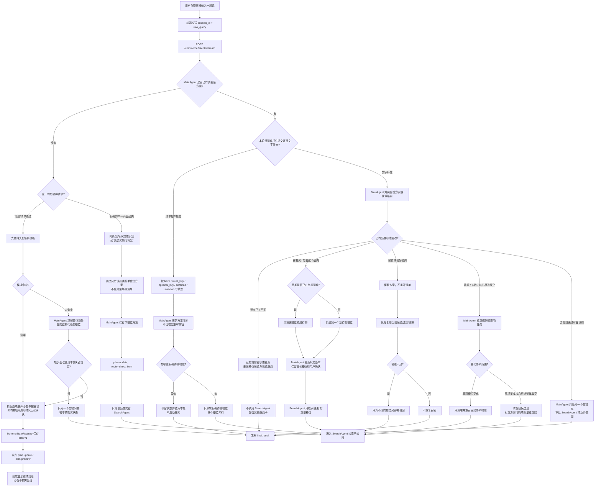
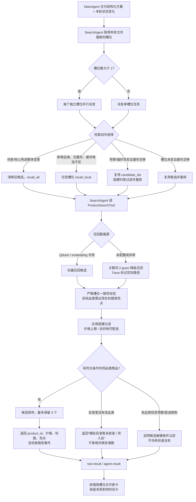
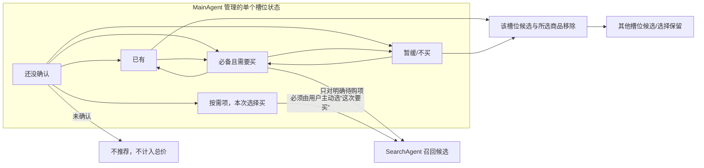

# ShopMind MVP：端到端细化流程

> 历史材料说明（2026-10-25）：本文保留早期方向/时点，当前产品定义、实现状态与验收边界请看[作品集总目录](portfolio/README.md)与[最新PRD](shopmind-task-to-plan-prd.md)。其中旧流程、旧指标及订单描述不能直接作为当前ShopMind能力结论。

状态：按 2026-10-22 已确认的架构实现；此文描述本地代码目标，未代表 GitHub / 公网部署状态。MainAgent 持有方案和用户状态，SearchAgent 只召回、过滤、排序；TradeAgent 仍关闭。MVP 终点是用户确认“这套采购方案”，不是创建真实订单。

## 1. 从输入到商品方案：前端和 MainAgent 的分支



## 2. SearchAgent 内部：任务槽位如何变成候选卡



## 3. 清单状态和候选的增量变化规则



`ShoppingPlan` 是用户任务事实的唯一状态来源；`CandidatePool` 只存每个槽位的候选 ID 和命中数，不反向推断用户“已有/要买/不买”。一次文字补充只更新对应槽位和 `state_version`。清单控件的结构化选择优先级最高，避免模型把点选状态重新解释错。

## 4. 选商品、合计和 MVP 终点

```mermaid
flowchart TD
  CARDS[每个待购槽位展示 0 到 3 个同品类卡片] --> PICK[用户为某槽位选择 0 或 1 件商品]
  PICK --> OPT{这是按需槽位?}
  OPT -->|是| INCLUDE[用户先主动将其标为“这次要买”]
  OPT -->|否| SELECTED[保存 picked[slot] = product_id]
  INCLUDE --> SELECTED
  SELECTED --> TOTAL[前端应用层确定性计算<br/>Σ 已选商品价格 × 默认数量 1]
  TOTAL --> BUDGET[显示商品价合计、预算上限和是否超预算<br/>不含运费；不调用 LLM / TradeAgent]
  BUDGET --> CONFIRM[用户确认这套采购方案]
  CONFIRM --> END[MVP 完成：仅记录模拟选择<br/>不加购物车、不创建真实订单]
  CONFIRM -. 未来用户明确要求下单并二次确认后 .-> TRADE[TradeAgent 才可被启用]
  TRADE --> CHECK[服务端校验商品/SKU、库存、数量、地址和最终价格]
  CHECK --> ORDER[创建订单；真实支付/物流仍需单独接入]
```

因此 UI 上的“加入比较”不再作为本轮采购总价的门槛：比较功能不参与合计；每个待购槽位直接选中一个候选，合计只看实际选中的商品。现阶段不接真实下单，TradeAgent 继续休眠。

## 5. 三场景验收口径

脚本路径：`scripts/acceptance_mvp_core_three.py`。每个核心场景各跑“场景清单 → 只确认一个待购槽位并召回 → 明确品类补充”三步。

| 场景 | 第一轮模板 | 清单确认验收槽位 | 明确补充验收槽位 |
|---|---|---|---|
| 出行 | `general_travel` | `旅行背包` | `腰包与防水包` |
| 开学 | `school_start` | `学习文具` | `笔记本支架` |
| 租房 | `rental_move_in` | `床品套件` | `收纳箱` |

逐项输出首条有效事件、首份清单、首张商品卡、整轮完成延迟；同时记录模型调用数、SearchAgent 派发数、搜索槽位、卡片数和返回卡片与目标槽位的一致率。卡片一致率是基于返回标题/亮点的严格品类校验，**不是标准召回率**；没有人工标注的完整相关 SKU 集时不报告 Recall@K。

本地修改状态：尚未 commit / push / 部署。
