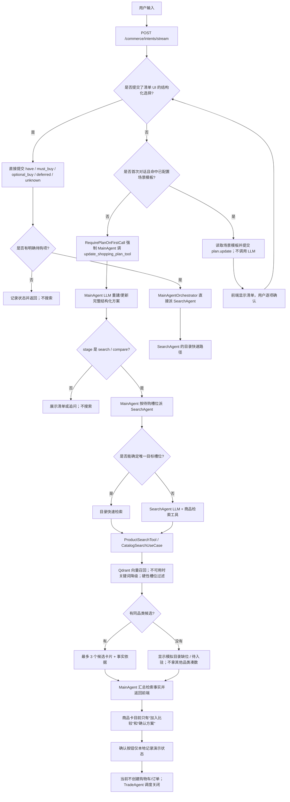
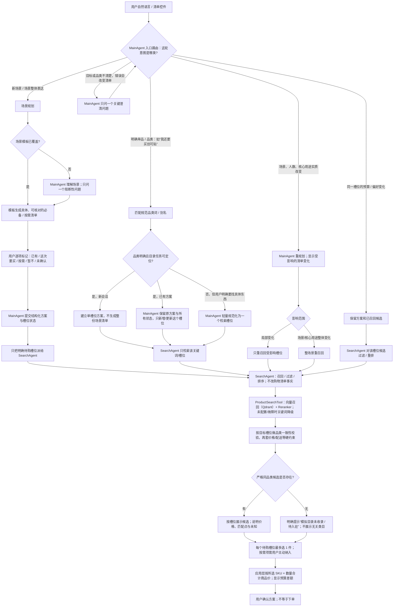
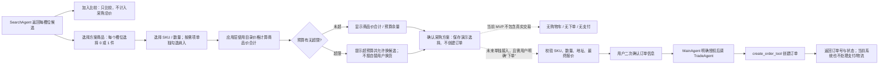

# ShopMind 用户需求到商品方案流程（历史草案）

> 历史材料说明（2026-10-25）：本文保留早期方向/时点，当前产品定义、实现状态与验收边界请看[作品集总目录](portfolio/README.md)与[最新PRD](shopmind-task-to-plan-prd.md)。其中旧流程、旧指标及订单描述不能直接作为当前ShopMind能力结论。

> 本文保留先前方案草案及改造前状态，避免把历史描述误当作当前代码。当前确认并实现中的详细流程见 [ShopMind MVP 端到端细化流程](shopmind-mvp-detailed-flow-20261022.md)；该实现仍是本地未提交版本。

## 1. 当前代码实际流程（现状）

### 当前会导致“补充具体商品却重新出清单”的原因

- 清单 UI 按钮有独立的 `checklist_selection` 快速路径；它能直接提交结构化状态并搜索待购槽位。
- 但用户在聊天框输入“我还想买创可贴”时，当前没有与之等价的“具体品类直达”分支。它会进入 MainAgent 的常规 LLM 回合，而且首个工具被强制为 `update_shopping_plan_tool`，因此模型可能重写整份方案、重新出现清单。
- 这不是 SearchAgent 主动决定重新规划；是自由文本先被 MainAgent 的完整方案更新流程接管。目标应是保留 MainAgent 的状态所有权，但让明确的单品/品类请求走原子槽位更新，再只派发受影响的 SearchAgent 任务。
- “加入比较”只表示比较候选，不代表纳入采购方案，也不能直接据此作为订单金额。
- 当前页面上的“方案总结 / 最低商品价”是按每个待购槽位取候选中的最低价相加，并不等于用户在卡片上勾选的商品；即使只勾选“加入比较”，这个数字也不会变化。它应在用户选定具体候选后，改为按“所选商品 × 数量”计算；这也是本次模拟区需要修正的展示口径。

## 2. 建议目标流程（待确认后再改模拟区）

### 意图路由规则（建议作为实现验收口径）

| 用户表达 | 由谁负责 | 是否重开整份清单 | SearchAgent 工作范围 |
|---|---|---:|---|
| “帮我准备开学/租房/出行清单” | MainAgent 场景规划；命中模板时优先用模板 | 是，首次建单 | 等用户确认待购项后搜索 |
| “我还想买创可贴 / 帮我搜泳衣” | MainAgent 维护方案状态；明确品类走直达路由 | 否；新会话只建单槽位 | 只召回创可贴/泳衣 |
| “沙滩垫换轻一点的 / 预算改为 300” | MainAgent 记录约束 | 否 | 优先复用该槽位候选过滤、重排；候选不足才局部补召回 |
| “改成露营三天 / 现在是 4 个人” | MainAgent 重看场景和受影响任务 | 仅显示受影响清单变更，不无故抹掉用户确认 | 局部变化局部召回；场景/核心用途变化才整场景重召回 |
| “再给我弄一下” | MainAgent | 不擅自重建 | 先问一个会改变结果的关键问题 |

“直接搜索”不是让 SearchAgent 负责理解所有业务意图。MainAgent 仍掌握用户目标、方案和状态；只是明确品类请求不再经过一次完整场景规划。规范词命中时可走轻量确定性路由；同义词不确定时才由 MainAgent 做一次短规范化，之后仍只向 SearchAgent 发单槽位任务。

## 3. 选商品、报价、下单的责任边界

- 方案商品价是确定性计算：`Σ(选中 SKU 单价 × 数量)`，不需要 LLM，也不应让 TradeAgent 猜金额。
- 如果产品暂时没有可选 SKU/数量，MVP 先以每槽位一件、目录主 SKU 价格显示“商品价估算（不含运费）”，明确这是估算，不声称到手价；一旦用户选中了具体候选，就不能再显示“每个槽位最低价相加”的金额。
- TradeAgent 是写订单的执行者，不是报价计算器。现在代码把 `task_dispatch` 的 `enable_trade` 设为 `false`，前端“确认这套采购方案”只记录演示状态；因此当前没有真正下单链路。

## 4. 出行、开学、租房三场景验收和指标

三场景各准备一条“场景表达 → 清单确认 → 明确品类补充/搜索 → 选择商品”的主路径；每条路径至少覆盖一次直接品类补充，验证它不会重新打开完整清单。

| 验收项 | 口径 |
|---|---|
| 首屏有效响应延迟 | 从用户发送到第一条有用反馈/清单可见；场景话术和单品话术分开统计 |
| 首份清单延迟 | 从场景话术发送到具体必备/按需清单显示；有模板时不等一次完整 LLM 生成 |
| 首批商品延迟 | 从用户确认某槽位待购，或明确提出单品搜索，到该槽位首张有效卡片显示 |
| 槽位命中率（可测） | 搜索槽位中至少返回 1 个正确品类候选的比例 |
| 商品相关率（可测） | 所有返回卡片中，品类与目标槽位严格一致的比例；任何无关类目均计错 |
| 召回率（需标注集） | 测试目录里预先标注的相关商品中，被检索到的比例；必须先有每个查询对应的相关商品 ID/标签，不能只凭模型输出估算 |
| 错误重规划率 | 明确单品补充后，方案未被整份重置且未再次展示全清单的比例，目标为 100% |

当前可以测端到端延迟、命中槽位和返回卡片的品类相关性；若没有每条测试查询对应的“全部相关商品/预期 SKU”标注，不能严谨地报告标准 IR Recall。三场景评测集应先定义每场景的标准槽位、别名、相关商品 ID 和禁止类目，再出召回率/准确率，避免把“返回了商品”误当“召回准确”。

## 5. 请你确认的决策点

1. 明确具体品类补充：保留 MainAgent 状态所有权，但不重走完整场景清单；只更新该槽位并定向调 SearchAgent。
2. 预算/偏好小调整：只重排/过滤当前槽位候选；场景、人数、核心用途实质改变才重规划，且按受影响范围决定局部或全量重召回。
3. 价格：区分“加入比较”和“纳入本次方案”。每槽位最多选一件，应用层计算商品价合计；TradeAgent 暂不参与。
4. MVP 的终点：先做到模拟目录、商品选择、总价和方案确认；真实下单/支付不在这轮模拟区改造中。未来如要下单，再单独设计用户二次确认 + TradeAgent。
5. 验收范围：出行、开学、租房各跑场景规划与商品搜索，并额外测明确品类补充直达路径；指标按上表，不虚报标准 Recall。

我先停在逻辑确认这一步，尚未改模拟区、后端路由、清单或商品选择交互。
